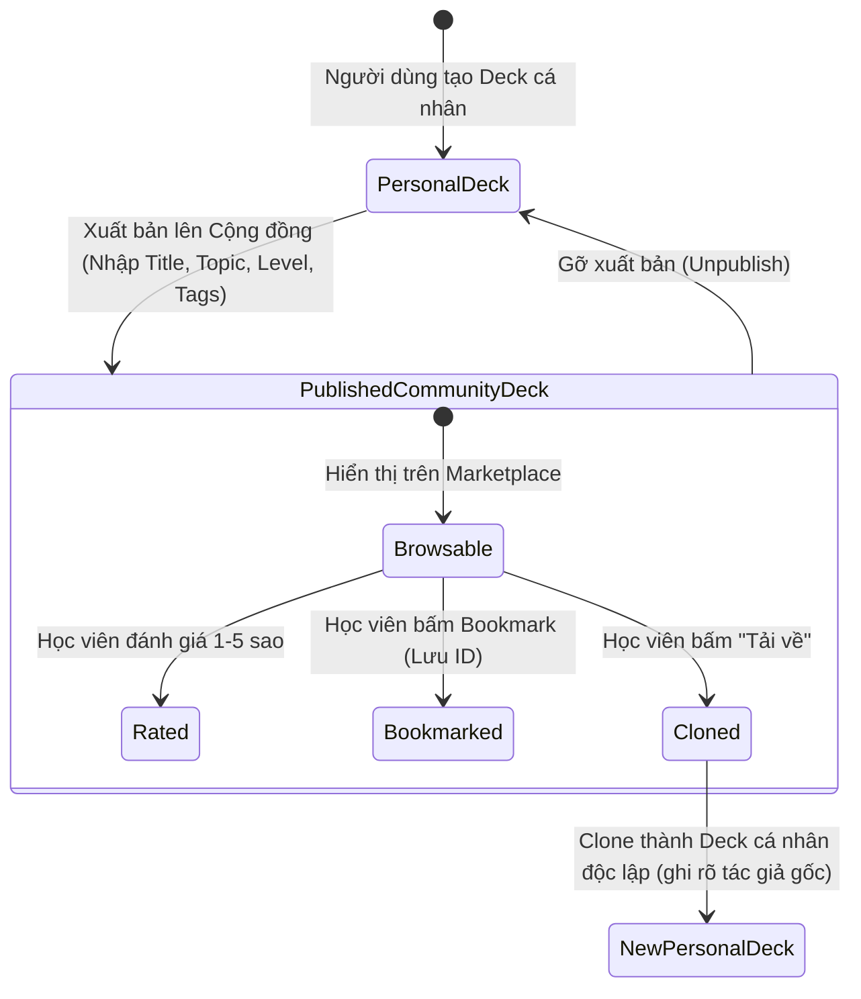
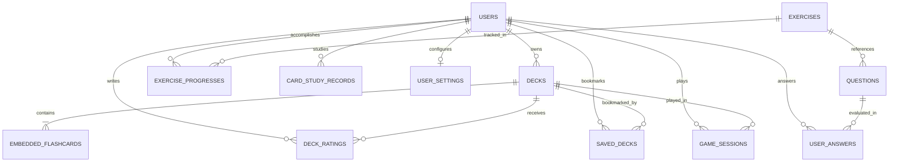
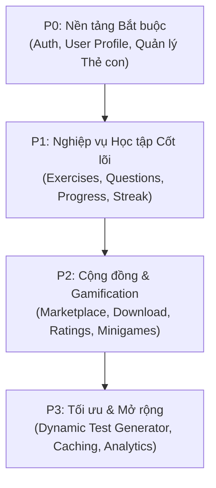

# TÀI LIỆU ĐẶC TẢ API BACKEND MONGODB CHO HỆ THỐNG JLPT STUDY

---

## 1. Project Overview (Tổng quan dự án)

### 1.1. Giới thiệu dự án
Dự án **JLPT Study Platform** là nền tảng e-learning chuyên sâu hỗ trợ học viên luyện thi năng lực Nhật ngữ (JLPT) từ cấp độ **N5** đến **N1**. Hệ thống bao gồm 4 kỹ năng cốt lõi:
1. **Từ vựng (Vocabulary)**
2. **Ngữ pháp (Grammar)**
3. **Nghe hiểu (Listening)**
4. **Đọc hiểu (Reading)**

Bên cạnh các bài luyện tập theo kỹ năng, hệ thống tích hợp giải pháp học tập tích cực qua **Flashcard** cá nhân và **Chợ học liệu cộng đồng (Community Decks)**, các minigame ôn tập tương tác (**Quiz Game**, **Matching Game**, **Smart Review** dựa trên thuật toán Spaced Repetition, **Speed Challenge**) và các bài thi thử mô phỏng (**Mini Test**, **Quiz 30p**, **JLPT Full Test**).

### 1.2. Mục đích tài liệu
Tài liệu này được biên soạn dựa trên quá trình đảo ngược (reverse engineering) và phân tích chuyên sâu toàn bộ source code Frontend (FE) hiện hữu (`React 18`, `TypeScript`, `TailwindCSS`, `Vite`) và hiện trạng khung Backend (BE) ban đầu (`NestJS`, `Mongoose`).

**Mục tiêu cốt lõi:**
- Định nghĩa đầy đủ, nhất quán 100% các API cần thiết để Backend triển khai trọn vẹn mà không cần suy đoán nghiệp vụ.
- Thiết kế hệ thống cơ sở dữ liệu NoSQL **MongoDB** tối ưu (lựa chọn giữa Embedding và Referencing có căn cứ).
- Chuẩn hóa mô hình Request/Response tương thích hoàn toàn với các `interface`/`type` TypeScript hiện có của Frontend, giảm thiểu tối đa việc tái cấu trúc giao diện.
- Cung cấp lộ trình và hướng dẫn chi tiết giúp Frontend loại bỏ hoàn toàn các tầng `mockData` và `localStorage` sang API thực tế.

---

## 2. Frontend Architecture Analysis (Phân tích kiến trúc Frontend)

### 2.1. Ngăn xếp công nghệ Frontend
- **Framework & Core:** React 18.3, TypeScript 5.x, Vite.
- **Routing:** `react-router-dom` v6/v7 với `createBrowserRouter`, triển khai cơ chế `ProtectedRoute` dựa trên token xác thực.
- **Styling & UI Components:** Tailwind CSS, Radix UI primitives (`@radix-ui/react-*`), Lucide React icons, Class Variance Authority (`cva`).
- **HTTP Client hiện tại:** Hỗn hợp giữa `fetch` API tự viết và lưu trữ cục bộ `localStorage`.

### 2.2. Khảo sát cấu trúc thư mục Frontend
```
FE/src/
├── app/
│   ├── components/       # Các Modal, Card, Flashcard, Layout dùng chung
│   │   ├── ActivityCalendar.tsx
│   │   ├── CardModal.tsx
│   │   ├── CommunityDeckCard.tsx
│   │   ├── DeckCard.tsx
│   │   ├── DeckModal.tsx
│   │   ├── ExerciseCard.tsx
│   │   ├── ExportPDFModal.tsx
│   │   ├── Flashcard.tsx
│   │   ├── JLPTTestModal.tsx
│   │   ├── MiniTestModal.tsx
│   │   ├── QuizModal.tsx
│   │   └── RandomExerciseModal.tsx
│   ├── data/             # Mock data tĩnh
│   │   ├── mockCommunity.ts   # Mock dữ liệu bộ thẻ cộng đồng & đánh giá
│   │   ├── mockData.ts        # Mock câu hỏi & bộ thẻ cơ sở
│   │   └── mockDecks.ts       # Sinh danh sách bộ thẻ mẫu cho phân trang
│   ├── pages/            # Các trang giao diện chính
│   │   ├── games/             # 4 chế độ game flashcard
│   │   │   ├── MatchingGame.tsx
│   │   │   ├── QuizGame.tsx
│   │   │   ├── SmartReview.tsx
│   │   │   └── SpeedChallenge.tsx
│   │   ├── Community.tsx
│   │   ├── CommunityDeckDetail.tsx
│   │   ├── Decks.tsx
│   │   ├── FlashcardView.tsx
│   │   ├── Home.tsx
│   │   ├── Login.tsx
│   │   ├── PracticeList.tsx
│   │   ├── PracticeResult.tsx
│   │   ├── PracticeSession.tsx
│   │   ├── Profile.tsx
│   │   ├── Progress.tsx
│   │   ├── Settings.tsx
│   │   └── StudyMode.tsx
│   ├── services/         # Tầng service giả lập dữ liệu
│   │   ├── communityService.ts # Mock API cho Community
│   │   └── gameService.ts      # Logic & lưu trữ session game, Spaced Repetition
│   ├── utils/            # Tầng giao tiếp API đã có & tiện ích cục bộ
│   │   ├── activityUtils.ts
│   │   ├── analytics.ts
│   │   ├── apiHeaders.ts
│   │   ├── authApi.ts
│   │   ├── deckStorage.ts
│   │   ├── exercises.ts
│   │   ├── exProgress.ts
│   │   └── storage.ts
│   ├── types.ts          # Định nghĩa toàn bộ TypeScript Type / Interface
│   ├── routes.tsx         # Bản đồ định tuyến ứng dụng
│   └── App.tsx
```

### 2.3. Đánh giá hiện trạng đồng bộ hóa Frontend - Backend
Hiện tại mã nguồn đang ở trạng thái **Hybrid (Lai ghép)**:
1. **Các module đã bước đầu nối API Backend (`BE/gr1_be`):**
   - Đăng nhập / Đăng ký (`/auth/login`, `/auth/register`).
   - Lấy danh sách & chi tiết bài tập (`/exercises`, `/exercises/findBy`, `/exercises/ByUserIandId`, `/exercises/:id/questions`).
   - Ghi nhận tiến độ bài tập (`/exercise-progress`).
   - Ghi nhận câu trả lời đơn lẻ (`/user-answers`).
   - Tạo, lấy, cập nhật deck cơ bản (`/decks`, `/decks/user/:id`, `/decks/:id/duplicate`).
2. **Các module còn phụ thuộc 100% vào `localStorage` hoặc `mockData`:**
   - **Thao tác chi tiết với từng Flashcard:** Thêm, sửa, xóa card bên trong Deck (`addCardToDeck`, `updateCard`, `deleteCard` trong `deckStorage.ts` vẫn ghi đè vào `localStorage` key `jlpt_decks`).
   - **Cộng đồng Flashcard (Community):** Tìm kiếm, lọc theo trình độ/chủ đề, sắp xếp, lưu bộ thẻ (`saved`), tải bộ thẻ (`download`), xuất bản thẻ (`publish/unpublish`) đều chạy trên `mockCommunity.ts` và `localStorage` key `jlpt_saved_community_decks`, `jlpt_published_deck_ids`.
   - **Đánh giá & Review bộ thẻ:** Gửi sao và bình luận lưu ở `jlpt_user_ratings`.
   - **Gamification & Học tập thông minh:** Lịch sử phiên game (`jlpt_game_sessions`), bản ghi học từng thẻ (`jlpt_card_study_records`).
   - **Tạo đề thi tự động:** Các Modal Mini Test, Quiz, JLPT Test chỉ mới dừng ở giao diện cấu hình, nút "Bắt đầu" chưa gọi API sinh đề thi động.
   - **Cài đặt người dùng:** Giao diện `Settings.tsx` lưu cấu hình trong `jlpt_settings`.

---

## 3. Existing Features Inventory (Danh mục chức năng hiện hữu)

Dưới đây là bảng phân tích toàn diện 18 chức năng được phân tách rõ ràng từ mã nguồn Frontend:

### 3.1. Phân tích chi tiết từng chức năng

#### Chức năng 1: Xác thực & Đăng nhập / Đăng ký (Authentication)
1. **Tên chức năng:** Đăng nhập & Đăng ký tài khoản người dùng.
2. **File triển khai:** `FE/src/app/pages/Login.tsx`, `FE/src/app/utils/authApi.ts`.
3. **Component/Page liên quan:** `Login.tsx`, `ProtectedRoute.tsx`.
4. **MockData đang sử dụng:** Không dùng mockData. Đã gọi API `/auth/login` và `/auth/register`.
5. **Interface/Type tương ứng:** Không có interface riêng trong `types.ts`, dữ liệu dạng `{ userName?, gmail, password }`.
6. **Các hàm xử lý:** `login()`, `signup()`.
7. **Thao tác người dùng:** Nhập Gmail và mật khẩu để đăng nhập hoặc đăng ký tài khoản mới; chuyển đổi qua lại giữa tab Login/Register.
8. **Dữ liệu đầu vào / đầu ra:**
   - Input: Gmail, password, userName (khi đăng ký).
   - Output: Object chứa `access_token` và `user` profile (`id`, `userName`, `gmail`, `point`, `streak`, ...). Lưu `token`, `access_token` và `user` vào `localStorage`.
9. **Quan hệ module khác:** Quyết định quyền truy cập vào tất cả các route bọc bởi `ProtectedRoute`.

#### Chức năng 2: Tổng quan & Bảng điều khiển học tập (Dashboard / Home)
1. **Tên chức năng:** Thống kê nhanh tiến độ, chuỗi streak, hoạt động gần đây và lối tắt luyện tập.
2. **File triển khai:** `FE/src/app/pages/Home.tsx`.
3. **Component/Page liên quan:** `Home.tsx`, `MiniTestModal.tsx`, `QuizModal.tsx`, `JLPTTestModal.tsx`.
4. **MockData đang sử dụng:** Dữ liệu tĩnh các danh mục kỹ năng `questionCategories` trong `mockData.ts`; biểu đồ 7 ngày qua đang hardcode mảng chiều cao `[65, 45, 80, 55, 90, 70, 85]`.
5. **Interface/Type tương ứng:** `QuestionCategory`, `ExerciseProgress`, `UserAnswer`.
6. **Các hàm xử lý:** `getUserAnswers()`, `getUserStats()`, `getUserProgress()`, `getTimeAgo()`.
7. **Thao tác người dùng:** Xem số câu đã làm, độ chính xác, điểm tích lũy, chuỗi ngày học; nhấp chuyển nhanh sang luyện 4 kỹ năng hoặc mở modal thi thử.
8. **Dữ liệu đầu vào / đầu ra:**
   - Input: `userId` (lấy từ `localStorage`).
   - Output: Render các thẻ KPI stats và danh sách 3 bài tập hoàn thành gần nhất.
9. **Quan hệ module khác:** Liên kết chặt chẽ với module `User`, `UserAnswer`, `ExerciseProgress`.

#### Chức năng 3: Danh sách bài tập luyện theo Kỹ năng & Trình độ (Practice List)
1. **Tên chức năng:** Duyệt bài tập theo kỹ năng (Từ vựng, Ngữ pháp, Nghe hiểu, Đọc hiểu) và cấp độ (N5 - N1).
2. **File triển khai:** `FE/src/app/pages/PracticeList.tsx`.
3. **Component/Page liên quan:** `PracticeList.tsx`, `ExerciseCard.tsx`, `RandomExerciseModal.tsx`.
4. **MockData đang sử dụng:** Không dùng mockData. Đã gọi API qua `getExercisesByTypeAndLevel()`.
5. **Interface/Type tương ứng:** `Exercise`, `JLPTLevel`, `QuestionType`.
6. **Các hàm xử lý:** `getExercisesByTypeAndLevel()`, tính điểm trung bình `avgScore`, đếm số bài đã xong `completedCount`.
7. **Thao tác người dùng:** Chọn cấp độ N5..N1 trên Header; lọc theo độ khó (`all`, `easy`, `medium`, `hard`); bấm "Luyện ngẫu nhiên" hoặc chọn bài tập cụ thể để làm.
8. **Dữ liệu đầu vào / đầu ra:**
   - Input: `userId`, `type` (param URL), `selectedLevel`, `filterDifficulty`.
   - Output: Danh sách bài tập kèm cờ trạng thái `completed`, `score`, `progressId`.
9. **Quan hệ module khác:** Điều hướng sang `PracticeSession` khi bấm vào bài tập.

#### Chức năng 4: Thực hiện phiên làm bài luyện tập (Practice Session)
1. **Tên chức năng:** Giao diện làm bài tập tương tác, phát audio nghe hiểu, đếm giờ, lưu kết quả từng câu.
2. **File triển khai:** `FE/src/app/pages/PracticeSession.tsx`.
3. **Component/Page liên quan:** `PracticeSession.tsx`.
4. **MockData đang sử dụng:** Đã gọi API `/exercises/ByUserIandId` và `/exercises/:id/questions`.
5. **Interface/Type tương ứng:** `Exercise`, `Question`, `UserAnswer`, `ExerciseProgress`.
6. **Các hàm xử lý:** `loadExercise()`, `getExercisesQuestion()`, `saveUserAnswer()`, `createNewExProgress()`, `updateExProgress()`, audio controls (`handlePlayPause`, `handleTimeUpdate`).
7. **Thao tác người dùng:** Nghe audio (nếu là bài nghe), đọc câu hỏi, chọn 1 trong 4 đáp án; xem giải thích đúng/sai tức thì; chuyển câu tiếp theo hoặc nộp bài.
8. **Dữ liệu đầu vào / đầu ra:**
   - Input: `exerciseId` (từ URL), đáp án người dùng chọn.
   - Output: Ghi nhận từng bản ghi câu trả lời qua `saveUserAnswer()`, tạo/cập nhật tiến độ `ExerciseProgress`, cập nhật điểm & streak vào User.
9. **Quan hệ module khác:** Chuyển hướng sang `PracticeResult` khi kết thúc bài tập.

#### Chức năng 5: Kết quả bài tập & Phân tích (Practice Result)
1. **Tên chức năng:** Hiển thị kết quả điểm số, xếp loại và phân tích số câu đúng/sai sau khi hoàn thành bài tập.
2. **File triển khai:** `FE/src/app/pages/PracticeResult.tsx`.
3. **Component/Page liên quan:** `PracticeResult.tsx`.
4. **MockData đang sử dụng:** Không dùng mockData. Đọc điểm từ query parameter `?score=...` và nạp thông tin bài tập từ API.
5. **Interface/Type tương ứng:** `Exercise`.
6. **Các hàm xử lý:** `getExerciseById()`, `getScoreMessage()`, `getScoreColor()`.
7. **Thao tác người dùng:** Xem điểm phần trăm, số câu đúng/sai; nút "Làm lại bài tập" hoặc "Quay lại danh sách".
8. **Dữ liệu đầu vào / đầu ra:**
   - Input: `exerciseId`, `score` (query string).
   - Output: Biểu đồ tròn điểm số, thông điệp khích lệ.
9. **Quan hệ module khác:** Kết nối trực tiếp với `PracticeSession` và `PracticeList`.

#### Chức năng 6: Quản lý Bộ thẻ Flashcard cá nhân (Personal Decks Management)
1. **Tên chức năng:** Danh sách, tạo mới, chỉnh sửa thông tin, nhân bản, xuất/nhập JSON và xóa bộ thẻ cá nhân.
2. **File triển khai:** `FE/src/app/pages/Decks.tsx`, `FE/src/app/utils/deckStorage.ts`.
3. **Component/Page liên quan:** `Decks.tsx`, `DeckCard.tsx`, `DeckModal.tsx`, `PublishDeckModal.tsx`.
4. **MockData đang sử dụng:** Khi chuyển sang tab "Cộng đồng" trong trang này, đang lấy dữ liệu từ `mockDecks` trong `mockData.ts`. Tab "Cá nhân" gọi API `/decks/user/:id`.
5. **Interface/Type tương ứng:** `Deck`, `Flashcard`, `PublishConfig`.
6. **Các hàm xử lý:** `getDecks()`, `createDeck()`, `updateDeck()`, `deleteDeck()`, `duplicateDeck()`, `exportDeck()`, `importDeck()`.
7. **Thao tác người dùng:** Tạo Deck mới (tên, mô tả, màu sắc, icon); chỉnh sửa Deck; nhân bản Deck; xuất Deck ra file JSON; nhập file JSON để tạo Deck; bấm nút "Xuất bản lên cộng đồng".
8. **Dữ liệu đầu vào / đầu ra:**
   - Input: Payload thông tin deck hoặc ID deck.
   - Output: Danh sách bộ thẻ hiển thị dạng lưới kèm phân trang (30 deck/trang), tìm kiếm theo tên/mô tả.
9. **Quan hệ module khác:** Chuyển sang `FlashcardView` để xem thẻ, `StudyMode` để chơi game, hoặc mở `PublishDeckModal`.

#### Chức năng 7: Quản lý thẻ Flashcard chi tiết trong Deck
1. **Tên chức năng:** Thêm thẻ mới, sửa nội dung thẻ, xóa thẻ, nhân bản thẻ bên trong một bộ thẻ.
2. **File triển khai:** `FE/src/app/components/CardModal.tsx`, `FE/src/app/utils/deckStorage.ts`.
3. **Component/Page liên quan:** `CardModal.tsx`, `FlashcardView.tsx`.
4. **MockData đang sử dụng:** `addCardToDeck()`, `updateCard()`, `deleteCard()`, `duplicateCard()` trong `deckStorage.ts` hiện tại chỉ ghi đè vào `localStorage.setItem('jlpt_decks', ...)` chứ chưa gọi API cập nhật mảng subdocument trên MongoDB.
5. **Interface/Type tương ứng:** `Flashcard`, `JLPTLevel`.
6. **Các hàm xử lý:** `addCardToDeck()`, `updateCard()`, `deleteCard()`, `duplicateCard()`.
7. **Thao tác người dùng:** Nhập mặt trước (tiếng Nhật), mặt sau (nghĩa/cách đọc), ví dụ câu, chọn loại (từ vựng/ngữ pháp), chọn trình độ N5..N1; lưu/sửa/xóa thẻ.
8. **Dữ liệu đầu vào / đầu ra:**
   - Input: Thông tin flashcard (`front`, `back`, `example`, `type`, `level`, `status`).
   - Output: Deck cập nhật danh sách `cards`.
9. **Quan hệ module khác:** Trực tiếp ảnh hưởng đến `FlashcardView`, `StudyMode` và các minigame.

#### Chức năng 8: Học lật thẻ Flashcard & Chế độ xem (Flashcard View)
1. **Tên chức năng:** Xem lật thẻ tương tác 2 mặt, xáo trộn thẻ (shuffle), chuyển qua lại giữa các thẻ.
2. **File triển khai:** `FE/src/app/pages/FlashcardView.tsx`, `FE/src/app/components/Flashcard.tsx`.
3. **Component/Page liên quan:** `FlashcardView.tsx`, `Flashcard.tsx`.
4. **MockData đang sử dụng:** Lấy dữ liệu Deck qua API `getDeckById(deckId)`.
5. **Interface/Type tương ứng:** `Deck`, `Flashcard`.
6. **Các hàm xử lý:** `getDeckById()`, `handleShuffle()`, `handleNext()`, `handlePrevious()`.
7. **Thao tác người dùng:** Nhấp vào thẻ để lật xem mặt sau, bấm phím mũi tên hoặc nút Next/Prev, bấm nút "Xáo trộn".
8. **Dữ liệu đầu vào / đầu ra:**
   - Input: `deckId`.
   - Output: Thẻ hiển thị với hiệu ứng 3D flip card, thanh tiến độ học.
9. **Quan hệ module khác:** Lối vào từ trang `Decks.tsx`, có nút điều hướng sang `StudyMode`.

#### Chức năng 9: Trung tâm chế độ ôn tập trò chơi (Study Mode Hub)
1. **Tên chức năng:** Dashboard tổng hợp tiến độ học của một Deck và danh sách 4 chế độ game.
2. **File triển khai:** `FE/src/app/pages/StudyMode.tsx`, `FE/src/app/services/gameService.ts`.
3. **Component/Page liên quan:** `StudyMode.tsx`.
4. **MockData đang sử dụng:** Tính toán thống kê bằng hàm `getDeckStudyStats()` đọc từ `localStorage` key `jlpt_card_study_records`.
5. **Interface/Type tương ứng:** `Deck`, `DeckStudyStats`.
6. **Các hàm xử lý:** `getDeckStudyStats()`.
7. **Thao tác người dùng:** Xem số thẻ đã học, số thẻ mới, độ chính xác tổng quan, danh sách các thẻ hay sai; chọn 1 trong 4 chế độ game (Trắc nghiệm, Nối cặp, Ôn tập thông minh, Thử thách tốc độ).
8. **Dữ liệu đầu vào / đầu ra:**
   - Input: `deckId`.
   - Output: Thông số độ chính xác, cảnh báo thẻ khó, điều hướng đến game tương ứng.
9. **Quan hệ module khác:** Điều hướng sang 4 trang con trong `pages/games/`.

#### Chức năng 10: Trò chơi Trắc nghiệm Flashcard (Quiz Game)
1. **Tên chức năng:** Sinh câu hỏi trắc nghiệm 4 lựa chọn từ các thẻ trong bộ thẻ, chấm điểm và lưu kết quả.
2. **File triển khai:** `FE/src/app/pages/games/QuizGame.tsx`, `FE/src/app/services/gameService.ts`.
3. **Component/Page liên quan:** `QuizGame.tsx`.
4. **MockData đang sử dụng:** Sinh câu hỏi bằng hàm thuần FE `generateQuizQuestions()`; lưu session vào `localStorage` key `jlpt_game_sessions`; lưu kết quả thẻ vào `jlpt_card_study_records`.
5. **Interface/Type tương ứng:** `QuizQuestion`, `QuizDirection`, `GameSession`, `CardStudyRecord`.
6. **Các hàm xử lý:** `generateQuizQuestions()`, `saveGameSession()`, `updateCardStudyRecord()`.
7. **Thao tác người dùng:** Chọn hướng dịch (Nhật -> Việt hoặc Việt -> Nhật), chọn số lượng câu (5, 10, 15, 20); trả lời từng câu; xem màn hình tổng kết điểm.
8. **Dữ liệu đầu vào / đầu ra:**
   - Input: Cấu hình game, đáp án lựa chọn.
   - Output: Object `GameSession` (thời gian làm, số câu đúng, danh sách `wrongCardIds`).
9. **Quan hệ module khác:** Cập nhật tỷ lệ sai của thẻ để phục vụ `SmartReview`.

#### Chức năng 11: Trò chơi Nối cặp từ vựng (Matching Game)
1. **Tên chức năng:** Trò chơi ghép nối từ tiếng Nhật ở cột trái với nghĩa tiếng Việt tương ứng ở cột phải theo thời gian thực.
2. **File triển khai:** `FE/src/app/pages/games/MatchingGame.tsx`, `FE/src/app/services/gameService.ts`.
3. **Component/Page liên quan:** `MatchingGame.tsx`.
4. **MockData đang sử dụng:** Sinh cột nối bằng `generateMatchingColumns()`; lưu session vào `localStorage`.
5. **Interface/Type tương ứng:** `MatchingItem`, `GameSession`.
6. **Các hàm xử lý:** `generateMatchingColumns()`, `saveGameSession()`.
7. **Thao tác người dùng:** Chọn số cặp (4 đến 8 cặp); bấm chọn 1 thẻ bên trái và 1 thẻ bên phải; hệ thống kiểm tra cặp đúng/sai và đổi trạng thái (`selected`, `matched`, `wrong`).
8. **Dữ liệu đầu vào / đầu ra:**
   - Input: Cấu hình số cặp, lượt click nối thẻ.
   - Output: Thời gian hoàn thành, số lần ghép sai, lưu `GameSession`.
9. **Quan hệ module khác:** Lưu lịch sử vào module Game Sessions.

#### Chức năng 12: Ôn tập thông minh theo Spaced Repetition (Smart Review)
1. **Tên chức năng:** Thuật toán phân loại và ưu tiên các thẻ cần ôn tập nhất (thẻ chưa học -> thẻ có tỷ lệ sai >= 50% -> thẻ quá 3 ngày chưa ôn).
2. **File triển khai:** `FE/src/app/pages/games/SmartReview.tsx`, `FE/src/app/services/gameService.ts`.
3. **Component/Page liên quan:** `SmartReview.tsx`.
4. **MockData đang sử dụng:** Đọc bản ghi học từ `localStorage` key `jlpt_card_study_records` và sắp xếp thẻ tại client bằng `getCardsForSmartReview()`.
5. **Interface/Type tương ứng:** `Flashcard`, `CardStudyRecord`.
6. **Các hàm xử lý:** `getCardsForSmartReview()`, `updateCardStudyRecord()`, `saveGameSession()`.
7. **Thao tác người dùng:** Luyện tập lần lượt các thẻ có độ ưu tiên cao nhất; tự đánh giá nhớ/quên hoặc trả lời câu hỏi trắc nghiệm.
8. **Dữ liệu đầu vào / đầu ra:**
   - Input: `deckId`, mảng `cards`.
   - Output: Cập nhật `timesStudied`, `timesCorrect`, `timesWrong`, `lastStudied`.
9. **Quan hệ module khác:** Quyết định trực tiếp đến hiệu quả học tập và hiển thị tại `StudyMode`.

#### Chức năng 13: Thử thách tốc độ 60 giây (Speed Challenge)
1. **Tên chức năng:** Trả lời trắc nghiệm nhanh với đồng hồ đếm ngược 60 giây, tích lũy điểm combo liên tiếp.
2. **File triển khai:** `FE/src/app/pages/games/SpeedChallenge.tsx`, `FE/src/app/services/gameService.ts`.
3. **Component/Page liên quan:** `SpeedChallenge.tsx`.
4. **MockData đang sử dụng:** Sinh câu hỏi ngẫu nhiên liên tục từ bộ thẻ; lưu kết quả vào `localStorage`.
5. **Interface/Type tương ứng:** `GameSession`, `CardStudyRecord`.
6. **Các hàm xử lý:** `updateCardStudyRecord()`, `saveGameSession()`.
7. **Thao tác người dùng:** Chọn đáp án nhanh nhất có thể trước khi hết giờ; điểm thưởng nhân theo chuỗi streak đúng liên tiếp.
8. **Dữ liệu đầu vào / đầu ra:**
   - Input: Đáp án người dùng chọn trong 60 giây.
   - Output: Điểm kỷ lục, số câu trả lời được, độ chính xác.
9. **Quan hệ module khác:** Lưu session vào lịch sử game của bộ thẻ.

#### Chức năng 14: Chợ bộ thẻ Cộng đồng (Community Decks Marketplace)
1. **Tên chức năng:** Khám phá, tìm kiếm, lọc theo cấp độ JLPT/chủ đề, sắp xếp và phân trang danh sách bộ thẻ do cộng đồng chia sẻ.
2. **File triển khai:** `FE/src/app/pages/Community.tsx`, `FE/src/app/services/communityService.ts`.
3. **Component/Page liên quan:** `Community.tsx`, `CommunityDeckCard.tsx`.
4. **MockData đang sử dụng:** Sử dụng 100% dữ liệu giả lập từ `mockCommunityDecks` (`mockCommunity.ts`) thông qua `fetchCommunityDecks()` và `fetchFeaturedSections()`.
5. **Interface/Type tương ứng:** `CommunityDeck`, `JLPTLevel`, `DeckTopic`, `CommunitySortOption`, `CommunityFilters`, `PaginatedResult`.
6. **Các hàm xử lý:** `fetchCommunityDecks()`, `fetchFeaturedSections()`, `isDeckSaved()`, `saveDeck()`, `unsaveDeck()`.
7. **Thao tác người dùng:**
   - Tìm kiếm từ khóa (tên bộ thẻ, mô tả, tác giả, tags).
   - Lọc theo JLPT Level (`all`, `N5`..`N1`) và Chủ đề (`vocabulary`, `grammar`, `kanji`, `conversation`, `other`).
   - Sắp xếp theo: Phổ biến nhất (`popular`), Mới nhất (`newest`), Đánh giá cao (`top-rated`), Tải nhiều nhất (`most-downloaded`).
   - Bấm Bookmark để lưu/bỏ lưu bộ thẻ vào danh sách yêu thích.
   - Xem các hàng nổi bật (Featured rows) khi không kích hoạt bộ lọc.
8. **Dữ liệu đầu vào / đầu ra:**
   - Input: Query params (`search`, `level`, `topic`, `sort`, `page`, `perPage`).
   - Output: Danh sách `CommunityDeck` phân trang và các mục Featured.
9. **Quan hệ module khác:** Điều hướng sang `CommunityDeckDetail` khi nhấp vào thẻ.

#### Chức năng 15: Chi tiết bộ thẻ cộng đồng & Tương tác (Community Deck Detail)
1. **Tên chức năng:** Xem chi tiết bộ thẻ cộng đồng, xem trước 5 thẻ đầu tiên, tải bộ thẻ về tài khoản cá nhân, lưu bookmark, xem bộ thẻ liên quan.
2. **File triển khai:** `FE/src/app/pages/CommunityDeckDetail.tsx`, `FE/src/app/services/communityService.ts`.
3. **Component/Page liên quan:** `CommunityDeckDetail.tsx`, `ExportPDFModal.tsx`.
4. **MockData đang sử dụng:** `fetchCommunityDeckById()`, `fetchRelatedDecks()`, `downloadDeck()`, `saveDeck()`, `unsaveDeck()` đang thao tác trên `mockCommunityDecks` và `localStorage`.
5. **Interface/Type tương ứng:** `CommunityDeck`, `DeckRating`.
6. **Các hàm xử lý:** `fetchCommunityDeckById()`, `downloadDeck()`, `saveDeck()`, `unsaveDeck()`, `fetchRelatedDecks()`.
7. **Thao tác người dùng:** Xem tác giả, số lượt tải, lượt lưu, số sao trung bình; lật xem trước 5 flashcard mẫu; bấm "Tải về" để sao chép vào bộ thẻ cá nhân; bấm mở modal in PDF; xem danh sách bộ thẻ tương tự.
8. **Dữ liệu đầu vào / đầu ra:**
   - Input: `deckId` (từ URL).
   - Output: Chi tiết thông tin Deck, trạng thái đã lưu hay chưa, trạng thái đã tải hay chưa.
9. **Quan hệ module khác:** Tương tác với module Personal Decks (tạo bản sao khi download), mở `ExportPDFModal`.

#### Chức năng 16: Đánh giá & Bình luận Bộ thẻ Cộng đồng (Deck Reviews & Ratings)
1. **Tên chức năng:** Đánh giá từ 1 đến 5 sao kèm bình luận cho bộ thẻ cộng đồng; hiển thị danh sách nhận xét của học viên khác.
2. **File triển khai:** `FE/src/app/pages/CommunityDeckDetail.tsx`, `FE/src/app/services/communityService.ts`.
3. **Component/Page liên quan:** `CommunityDeckDetail.tsx`.
4. **MockData đang sử dụng:** `generateMockRatings()` sinh ngẫu nhiên đánh giá mẫu; đánh giá của người dùng hiện tại lưu trong `localStorage` key `jlpt_user_ratings`.
5. **Interface/Type tương ứng:** `DeckRating`.
6. **Các hàm xử lý:** `fetchDeckRatings()`, `getUserRating()`, `submitRating()`.
7. **Thao tác người dùng:** Nhấp chọn số sao (1-5 sao), viết nhận xét và bấm "Gửi đánh giá"; xem phân bố đánh giá và bình luận của người khác.
8. **Dữ liệu đầu vào / đầu ra:**
   - Input: `deckId`, `rating` (1..5), `comment` (tuỳ chọn).
   - Output: Danh sách đánh giá cập nhật, tính lại điểm trung bình của Deck.
9. **Quan hệ module khác:** Cập nhật trường `rating` và `ratingCount` trên `CommunityDeck`.

#### Chức năng 17: Xuất bản bộ thẻ cá nhân lên Cộng đồng (Publish / Unpublish Deck)
1. **Tên chức năng:** Chia sẻ một bộ thẻ từ danh sách cá nhân lên Chợ cộng đồng với thông tin cấu hình (tiêu đề, cấp độ, chủ đề, tags), hoặc gỡ khỏi cộng đồng.
2. **File triển khai:** `FE/src/app/components/PublishDeckModal.tsx`, `FE/src/app/pages/Decks.tsx`, `FE/src/app/services/communityService.ts`.
3. **Component/Page liên quan:** `PublishDeckModal.tsx`, `Decks.tsx`.
4. **MockData đang sử dụng:** Đang lưu mảng ID các deck đã xuất bản vào `localStorage` key `jlpt_published_deck_ids`.
5. **Interface/Type tương ứng:** `PublishConfig`, `CommunityDeck`.
6. **Các hàm xử lý:** `publishDeck()`, `unpublishDeck()`, `isDeckPublished()`.
7. **Thao tác người dùng:** Mở modal xuất bản; chọn bộ thẻ cá nhân; nhập tiêu đề hiển thị, mô tả, chọn Level N5..N1, chọn Topic, nhập tags; bấm "Xuất bản"; hoặc bấm "Gỡ khỏi cộng đồng" ở trang Decks.
8. **Dữ liệu đầu vào / đầu ra:**
   - Input: `PublishConfig` (`deckId`, `title`, `description`, `jlptLevel`, `topic`, `tags`).
   - Output: Cập nhật cờ `isPublic: true`, `visibility: 'community'`.
9. **Quan hệ module khác:** Deck sau khi xuất bản sẽ xuất hiện trên trang `Community.tsx`.

#### Chức năng 18: Thống kê & Phân tích Tiến độ học tập (Progress & Analytics)
1. **Tên chức năng:** Phân tích tỷ lệ chính xác, thời gian làm bài trung bình theo từng kỹ năng; xem biểu đồ và lịch sử học tập.
2. **File triển khai:** `FE/src/app/pages/Progress.tsx`, `FE/src/app/utils/analytics.ts`.
3. **Component/Page liên quan:** `Progress.tsx`, `ActivityCalendar.tsx`, `DayActivityDetail.tsx`.
4. **MockData đang sử dụng:** Đọc từ API `/user-answers/user/:userId` và tính toán client-side qua `calculateProgressStats()`. Các hàm lịch học trong `activityUtils.ts` có chứa hàm giả lập `generateMockActivityData()`.
5. **Interface/Type tương ứng:** `ProgressStats`, `UserAnswer`, `DayActivity`, `ExerciseDetail`.
6. **Các hàm xử lý:** `getUserAnswers()`, `calculateProgressStats()`, `getTypeTitle()`, `getAccuracyColor()`.
7. **Thao tác người dùng:** Xem tổng số câu hỏi đã làm, độ chính xác trung bình; phân tích chi tiết theo 4 kỹ năng (Từ vựng, Ngữ pháp, Nghe hiểu, Đọc hiểu).
8. **Dữ liệu đầu vào / đầu ra:**
   - Input: `userId`.
   - Output: Mảng `ProgressStats[]` chứa `{ type, total, correct, incorrect, accuracy, averageTime }`.
9. **Quan hệ module khác:** Lấy dữ liệu từ bảng lưu vết câu trả lời `UserAnswer`.

#### Chức năng 19: Hồ sơ người dùng & Thành tựu (User Profile & Achievements)
1. **Tên chức năng:** Hiển thị thông tin cá nhân, cấp độ hiện tại, chuỗi ngày học, điểm tích lũy, huy hiệu thành tựu và lịch sử làm bài tập gần nhất.
2. **File triển khai:** `FE/src/app/pages/Profile.tsx`.
3. **Component/Page liên quan:** `Profile.tsx`.
4. **MockData đang sử dụng:** Danh sách danh hiệu `achievements` đang hardcode tĩnh 6 danh hiệu (Người mới bắt đầu, Streak Master, Từ vựng Guru, ...); số ngày học `studyDays: 45` đang hardcode.
5. **Interface/Type tương ứng:** `ExerciseProgress`, thông tin user.
6. **Các hàm xử lý:** `getUserStats()`, `getUserAnswers()`, `getUserProgress()`.
7. **Thao tác người dùng:** Xem thông tin cá nhân, tổng số câu hỏi, độ chính xác, chuỗi streak, huy hiệu đã mở khóa và lịch sử làm bài tập gần đây.
8. **Dữ liệu đầu vào / đầu ra:**
   - Input: `userId`.
   - Output: Thông tin tài khoản và bảng thành tích.
9. **Quan hệ module khác:** Đọc dữ liệu từ `User`, `UserAnswer`, `ExerciseProgress`.

#### Chức năng 20: Cài đặt hệ thống & Tuỳ chọn người dùng (Settings)
1. **Tên chức năng:** Quản lý thông tin tài khoản, mật khẩu, tùy biến giao diện, thông báo, mục tiêu học tập hàng ngày và quyền riêng tư.
2. **File triển khai:** `FE/src/app/pages/Settings.tsx`.
3. **Component/Page liên quan:** `Settings.tsx`.
4. **MockData đang sử dụng:** Toàn bộ lưu trữ vào `localStorage` key `jlpt_settings`; chức năng đổi mật khẩu chưa gọi API.
5. **Interface/Type tương ứng:** Dữ liệu settings cục bộ.
6. **Các hàm xử lý:** `handleSave()`, `handleLogout()`.
7. **Thao tác người dùng:**
   - Tài khoản: đổi tên hiển thị, đổi mật khẩu.
   - Giao diện: chọn theme (light/dark), ngôn ngữ (vi/ja/en), cỡ chữ.
   - Thông báo: bật/tắt email, push notifications, nhắc học.
   - Học tập: mục tiêu câu hỏi/ngày (dailyGoal), tự động phát âm thanh (autoPlayAudio), hiện giải thích ngay.
   - Bảo mật: chế độ hiển thị profile (public/private).
8. **Dữ liệu đầu vào / đầu ra:**
   - Input: Các giá trị tùy chọn cấu hình.
   - Output: Lưu cấu hình người dùng.
9. **Quan hệ module khác:** Tác động đến hành vi âm thanh ở `PracticeSession`, mục tiêu câu hỏi ở `Home`.

#### Chức năng 21: Xuất file in Flashcard PDF (Export PDF)
1. **Tên chức năng:** Cấu hình và tạo trang in flashcard theo chuẩn A4/Letter (in 1 mặt hoặc 2 mặt) để học offline.
2. **File triển khai:** `FE/src/app/components/ExportPDFModal.tsx`.
3. **Component/Page liên quan:** `ExportPDFModal.tsx`.
4. **MockData đang sử dụng:** Nhận trực tiếp object `deck` truyền từ props và dùng `window.print()` bằng HTML/CSS template client-side.
5. **Interface/Type tương ứng:** `PDFExportConfig`, `Deck`, `CommunityDeck`.
6. **Các hàm xử lý:** `generatePrintHTML()`.
7. **Thao tác người dùng:** Chọn khổ giấy (A4 / Letter), chọn bố cục (Chỉ mặt trước / Hai mặt trước sau), tuỳ chọn ẩn/hiện cách đọc và ví dụ; bấm "In / Lưu PDF".
8. **Dữ liệu đầu vào / đầu ra:**
   - Input: `PDFExportConfig`, dữ liệu `Deck`.
   - Output: Cửa sổ in trình duyệt (`window.print()`).
9. **Quan hệ module khác:** Không bắt buộc API backend riêng biệt nhưng có thể bổ sung API tạo PDF server-side nếu cần xuất file nhị phân chuẩn.

#### Chức năng 22: Tạo đề thi thử động (Mini Test, Quiz, JLPT Test, Random Exercise)
1. **Tên chức năng:** Khởi tạo bài thi trắc nghiệm tổng hợp theo tỷ lệ kỹ năng tùy chỉnh hoặc đề thi thử chuẩn JLPT.
2. **File triển khai:** `FE/src/app/components/MiniTestModal.tsx`, `QuizModal.tsx`, `JLPTTestModal.tsx`, `RandomExerciseModal.tsx`.
3. **Component/Page liên quan:** `Home.tsx`, `PracticeList.tsx`.
4. **MockData đang sử dụng:** Hiện tại các modal chỉ nhận input từ người dùng (Level, % từng kỹ năng), khi bấm "Bắt đầu thi" sự kiện chỉ đóng modal mà chưa tạo bài thi.
5. **Interface/Type tương ứng:** `JLPTLevel`, `QuestionType`.
6. **Các hàm xử lý:** `handlePercentageChange()`, `handleStart()`.
7. **Thao tác người dùng:**
   - Mini Test: Chọn Level N5..N1, kéo thanh trượt % tỷ lệ 4 kỹ năng (Từ vựng, Ngữ pháp, Nghe, Đọc) sao cho tổng = 100%, thời gian 15 phút, 20 câu.
   - Quiz: Chọn Level N5..N1, thời gian 30 phút, 40 câu.
   - JLPT Test: Chọn Level N5..N1, thời gian 100-170 phút, 50-120 câu chuẩn format JLPT thật.
   - Random Exercise: Chọn Level, hệ thống bốc ngẫu nhiên một bài tập đã có.
8. **Dữ liệu đầu vào / đầu ra:**
   - Input: `level`, cấu hình tỷ lệ câu hỏi, thời gian.
   - Output: Cần Backend trả về một đề thi ảo (bài tập tạm thời hoặc mảng câu hỏi trích xuất ngẫu nhiên từ kho câu hỏi).
9. **Quan hệ module khác:** Khởi tạo phiên làm bài tương tự `PracticeSession`.

---

## 4. MockData Analysis (Phân tích chi tiết MockData & LocalStorage)

### 4.1. Danh mục các file MockData tĩnh

| File Path | Biến / Hàm xuất bản | Cấu trúc dữ liệu | Mục đích sử dụng | Đánh giá chuyển đổi API |
|---|---|---|---|---|
| `FE/src/app/data/mockData.ts` | `questionCategories` | `QuestionCategory[]` (type, title, description, icon, color) | Danh mục 4 kỹ năng ở trang Home | Cố định trên FE hoặc chuyển thành API cấu hình hệ thống |
| `FE/src/app/data/mockData.ts` | `mockQuestions` | `Question[]` (_id, type, level, question, options, correctAnswer, explanation) | 4 câu hỏi mẫu q1..q4 | Đã có collection `questions` trong BE MongoDB, thay thế hoàn toàn |
| `FE/src/app/data/mockData.ts` | `mockDecks` | `Deck[]` (gọi `generateMockDecks()`) | Danh sách bộ thẻ mẫu tab Community ở trang Decks | Thay thế bằng API lấy danh sách Community Decks từ DB |
| `FE/src/app/data/mockDecks.ts` | `generateMockDecks()` | Sinh mảng 24 Deck với tên, mô tả, level, cardCount, màu, icon ngẫu nhiên | Dữ liệu mẫu test phân trang trang Decks | Bỏ hoàn toàn, thay thế bằng dữ liệu từ collection `decks` |
| `FE/src/app/data/mockCommunity.ts` | `AUTHORS` | Mảng 8 tác giả (id, name, avatar) | Tác giả giả lập cho bộ thẻ cộng đồng | Thay bằng trường `authorId` tham chiếu collection `users` |
| `FE/src/app/data/mockCommunity.ts` | `mockCommunityDecks` | Mảng 20+ bộ thẻ cộng đồng đầy đủ thông số (rating, downloadCount, saveCount, cards, tags) | Toàn bộ dữ liệu hiển thị trang `Community.tsx` | Chuyển thành collection `decks` (với filter `isPublic: true`) |
| `FE/src/app/data/mockCommunity.ts` | `generateMockRatings()` | Sinh ngẫu nhiên mảng `DeckRating[]` cho mỗi deck | Đánh giá & bình luận ở trang chi tiết | Chuyển thành collection `deck_ratings` trong MongoDB |

### 4.2. Danh mục khóa lưu trữ LocalStorage

| Storage Key | Kiểu dữ liệu lưu trữ | File truy cập | Mục đích nghiệp vụ hiện tại | Phương án thay thế Backend API |
|---|---|---|---|---|
| `token` / `access_token` | `string` (JWT) | `authApi.ts`, `apiHeaders.ts` | Lưu trữ Access Token xác thực các request | **Giữ nguyên** trên FE để gán vào Header `Authorization: Bearer <token>` |
| `user` | `JSON string` (`{ id, userName, gmail, ... }`) | `Home.tsx`, `Decks.tsx`, `Profile.tsx`, `communityService.ts` | Cache thông tin người dùng đang đăng nhập | Lưu thông tin cơ bản sau login; fetch thông tin tươi từ `GET /users/profile` |
| `jlpt_user_answers` | `JSON string` (`UserAnswer[]`) | `storage.ts` | Lịch sử câu trả lời (fallback khi không có API) | Đã có API `POST /user-answers` và `GET /user-answers/user/:userId`. Xóa hẳn fallback localStorage |
| `jlpt_custom_decks` | `JSON string` (`Deck[]`) | `storage.ts` | Lưu bộ thẻ tạo thủ công ở phiên bản cũ | Đã có API `POST /decks` và `GET /decks/user/:id`. Xóa bỏ |
| `jlpt_decks` | `JSON string` (`Deck[]`) | `deckStorage.ts` | Cache bộ thẻ và thực hiện thao tác thêm/sửa/xóa card | Thay bằng các API thao tác thẻ: `POST /decks/:id/cards`, `PATCH /decks/:id/cards/:cardId`, `DELETE /decks/:id/cards/:cardId` |
| `jlpt_saved_community_decks` | `JSON string` (`string[]` deckIds) | `communityService.ts` | Danh sách ID các bộ thẻ cộng đồng học viên đã lưu/bookmark | Chuyển sang API `POST /community/saved/:deckId`, `DELETE /community/saved/:deckId`, `GET /community/saved` |
| `jlpt_user_ratings` | `JSON string` (`Record<deckId, {rating, comment}>`) | `communityService.ts` | Lưu đánh giá số sao của người dùng hiện tại | Chuyển sang API `POST /community/decks/:id/ratings`, `GET /community/decks/:id/ratings/me` |
| `jlpt_published_deck_ids` | `JSON string` (`string[]` deckIds) | `communityService.ts` | Danh sách ID các deck cá nhân đã được người dùng xuất bản | Đổi trạng thái `isPublic: true` trực tiếp trên document `decks` thông qua `POST /community/decks/publish` |
| `jlpt_game_sessions` | `JSON string` (`GameSession[]`) | `gameService.ts` | Lịch sử kết quả các lượt chơi minigame (Quiz, Nối cặp, Tốc độ) | Chuyển sang API `POST /game-sessions`, `GET /game-sessions?deckId=...` |
| `jlpt_card_study_records` | `JSON string` (`Record<deckId_cardId, CardStudyRecord>`) | `gameService.ts` | Nhật ký học từng thẻ (số lần học, số lần đúng/sai, ngày học cuối) | Chuyển sang collection `card_study_records` với API `POST /study-records/card` |
| `jlpt_settings` | `JSON string` (Cấu hình) | `Settings.tsx` | Tùy chọn giao diện, thông báo, mục tiêu ngày | Chuyển sang API `GET /users/settings` và `PATCH /users/settings` |

---

## 5. Business Logic Analysis (Phân tích quy tắc nghiệp vụ)

### 5.1. Quy tắc Tính chuỗi ngày học liên tục (Streak) & Điểm thưởng (Points)
Hiện tại logic này đã được cài đặt mẫu trong `BE/gr1_be/src/exercise-progress/exercise-progress.service.ts`:
- **Chu kỳ ngày:** Xác định theo mốc 00:00:00 của ngày hiện tại (`startOfDay`).
- **Quy tắc Streak:**
  - Nếu `lastStudyDate` rỗng (lần đầu học): `streak = 1`.
  - Nếu `lastStudyDate` thuộc **hôm nay**: Giữ nguyên `streak`.
  - Nếu `lastStudyDate` thuộc **hôm qua**: Tăng `streak = streak + 1`.
  - Nếu `lastStudyDate` trước hôm qua (bị đứt chuỗi ít nhất 1 ngày): Đặt lại `streak = 1`.
- **Cộng điểm (Points):** Mỗi khi hoàn thành bài tập, điểm bài tập (`score` hoặc `point`) được cộng dồn trực tiếp vào trường `point` của User qua toán tử `$inc: { point }`.

### 5.2. Thuật toán Lặp lại ngắt quãng & Ưu tiên ôn tập thông minh (Smart Review)
Được trích xuất từ `FE/src/app/services/gameService.ts` (`getCardsForSmartReview`):
Hệ thống tính toán trọng số ưu tiên của từng Flashcard dựa trên bản ghi `CardStudyRecord`:
1. **Ưu tiên 1 (Cao nhất): Thẻ mới tinh chưa từng học** (`timesStudied === 0` hoặc chưa có bản ghi).
2. **Ưu tiên 2: Thẻ có tỷ lệ sai cao** (`timesWrong / timesStudied >= 0.5`). Tỷ lệ sai càng cao thì xếp càng lên trước.
3. **Ưu tiên 3: Thẻ bị lãng quên (Stale)**: Thẻ đã học nhưng lần cuối cách đây hơn **3 ngày** (`Date.now() - lastStudied > 3 * 24 * 60 * 60 * 1000`).
4. **Ưu tiên 4: Thẻ đã nắm vững**: Thẻ học thường xuyên và tỷ lệ sai thấp (< 50%).

### 5.3. Quy trình Xuất bản & Tải bộ thẻ Cộng đồng (Community Deck Lifecycle)

- **Xuất bản:** Chuyển trạng thái `isPublic: true`, thiết lập metadata chia sẻ (`topic`, `jlptLevel`, `tags`, `authorId`, `publishedAt`).
- **Tải về (Download):** Tạo một bản ghi mới trong collection `decks` thuộc sở hữu của người tải (`userId = currentUser._id`), kế thừa toàn bộ danh sách thẻ, đổi tên kèm hậu tố `(Tải về)` và tự động tăng trường `downloadCount` của bộ thẻ gốc thêm 1.
- **Đánh giá:** Mỗi người dùng chỉ được gửi 1 đánh giá cho mỗi bộ thẻ (nếu gửi lại sẽ cập nhật đánh giá cũ). Hệ thống tự động tính toán lại `rating` trung bình và `ratingCount` trên Deck.

### 5.4. Quy trình Sinh đề thi thử ngẫu nhiên (Mock Tests Generation)
- **Mini Test (15 phút, 20 câu):** Người dùng nhập tỷ lệ % cho 4 kỹ năng sao cho tổng bằng 100%. Số câu mỗi kỹ năng = `(tỷ lệ % / 100) * 20`. Hệ thống bốc ngẫu nhiên số lượng câu hỏi tương ứng theo `level` đã chọn từ kho `questions`.
- **Quiz Test (30 phút, 40 câu):** Bốc 40 câu hỏi cân bằng 4 kỹ năng theo trình độ chỉ định.
- **JLPT Full Test (100 - 170 phút):** Cấu trúc đề chuẩn JLPT theo số lượng câu hỏi quy định cho từng cấp độ:
  - N5: 50 câu (100 phút).
  - N4: 70 câu (120 phút).
  - N3: 90 câu (140 phút).
  - N2: 110 câu (155 phút).
  - N1: 120 câu (170 phút).

---

## 6. MongoDB Database Design (Thiết kế cơ sở dữ liệu MongoDB)

### 6.1. Phân tích Chiến lược Embedding vs Referencing
Việc thiết kế Schema MongoDB cần bám sát bản chất truy vấn và quy mô dữ liệu của ứng dụng:

1. **Flashcards trong Deck:**
   - **Lựa chọn:** **Embedding (Nhúng)** mảng `cards: [FlashcardSchema]` vào bên trong Document `Deck`.
   - **Căn cứ:** Bộ thẻ flashcard trong thực tế thường dao động từ 10 đến tối đa 200 thẻ. Kích thước 1 flashcard rất nhỏ (~150 bytes), 200 thẻ chỉ chiếm ~30KB (rất an toàn so với giới hạn 16MB/document của MongoDB). Hơn nữa, khi mở màn hình Flashcard hoặc chơi Game, giao diện luôn yêu cầu tải toàn bộ thẻ của Deck đó cùng lúc. Embedding đảm bảo chỉ cần 1 truy vấn duy nhất, không cần `$lookup` tốn chi phí.
2. **Questions trong Exercise:**
   - **Lựa chọn:** **Referencing (Tham chiếu)** thông qua mảng `questionIDs: [ObjectId]`.
   - **Căn cứ:** Các câu hỏi trắc nghiệm có nội dung giải thích, hình ảnh, âm thanh khá lớn và quan trọng nhất là các câu hỏi này cần được tái sử dụng trong nhiều bài tập hoặc đề thi ngẫu nhiên (Mini Test, JLPT Full Test).
3. **User Answers & Exercise Progress:**
   - **Lựa chọn:** **Referencing (Tách collection riêng)**.
   - **Căn cứ:** Dữ liệu lịch sử tăng trưởng không giới hạn theo thời gian (Unbounded Array). Nhúng vào User sẽ gây tràn document 16MB và suy giảm nghiêm trọng hiệu năng đọc/ghi profile.
4. **Deck Ratings & Game Sessions & Study Records:**
   - **Lựa chọn:** **Referencing**.
   - **Căn cứ:** Độc lập với Deck, cần phân trang và cập nhật liên tục với tần suất cao.

### 6.2. Sơ đồ Quan hệ Thực thể (Entity Relationship Diagram)



---

## 7. Collection Schema Specification (Đặc tả chi tiết Schema các Collection)

### 7.1. Collection: `users`
- **Mục đích:** Lưu trữ tài khoản người dùng, chứng thực và các chỉ số tích lũy học tập tổng quan.

| Field | Data Type | Required | Default | Description |
|---|---|---|---|---|
| `_id` | `ObjectId` | Yes | Auto | Định danh duy nhất của người dùng |
| `userName` | `String` | Yes | None | Tên hiển thị của học viên |
| `gmail` | `String` | Yes | None | Địa chỉ Gmail dùng đăng nhập (Unique) |
| `password` | `String` | Yes | None | Mật khẩu băm (bcrypt hash) |
| `avatar` | `String` | No | `""` | Đường dẫn ảnh đại diện |
| `currentLevel` | `String` | No | `"N5"` | Cấp độ JLPT mục tiêu (`N5`..`N1`) |
| `point` | `Number` | Yes | `0` | Tổng điểm thưởng tích lũy |
| `streak` | `Number` | Yes | `0` | Số ngày học liên tục hiện tại |
| `totalQuestion`| `Number` | Yes | `0` | Tổng số câu hỏi đã làm |
| `rightAnswer` | `Number` | Yes | `0` | Số câu trả lời đúng |
| `lastStudyDate`| `Date` | No | `null` | Thời điểm gần nhất phát sinh hoạt động học |
| `isDeleted` | `Boolean` | Yes | `false` | Cờ xóa mềm (Soft delete) |
| `createdAt` | `Date` | Yes | `Date.now` | Thời điểm tạo tài khoản |
| `updatedAt` | `Date` | Yes | `Date.now` | Thời điểm cập nhật cuối |

- **Validation & Unique Constraints:**
  - `gmail`: Bắt buộc, định dạng email chuẩn, duy nhất toàn hệ thống (`unique: true`).
  - `password`: Tối thiểu 6 ký tự trước khi băm.
- **Indexes:**
  - `gmail: 1` (Unique)
  - `point: -1` (Xếp hạng bảng thành tích)
- **Document mẫu JSON:**
```json
{
  "_id": "6640c1e8f1b2c3d4e5f6a701",
  "userName": "Nguyễn Minh Tú",
  "gmail": "minhtu.jlpt@gmail.com",
  "password": "$2b$10$w8T0zH9.X3Z91xQ89...",
  "avatar": "https://api.dicebear.com/7.x/avataaars/svg?seed=Tu",
  "currentLevel": "N4",
  "point": 1250,
  "streak": 7,
  "totalQuestion": 340,
  "rightAnswer": 289,
  "lastStudyDate": "2026-11-08T10:30:00.000Z",
  "isDeleted": false,
  "createdAt": "2026-06-01T08:00:00.000Z",
  "updatedAt": "2026-11-08T10:30:00.000Z"
}
```

---

### 7.2. Collection: `decks`
- **Mục đích:** Lưu trữ các bộ thẻ Flashcard (cả cá nhân và cộng đồng) cùng danh sách các thẻ nhúng bên trong.

| Field | Data Type | Required | Default | Description |
|---|---|---|---|---|
| `_id` | `ObjectId` | Yes | Auto | Định danh duy nhất của bộ thẻ |
| `userId` | `ObjectId` | Yes | None | Tham chiếu `users._id` (chủ sở hữu/tác giả) |
| `name` | `String` | Yes | None | Tên bộ thẻ flashcard |
| `description` | `String` | No | `""` | Mô tả chi tiết nội dung bộ thẻ |
| `color` | `String` | No | `"#3B82F6"`| Mã màu thẻ hiển thị (HEX) |
| `icon` | `String` | No | `"📚"` | Biểu tượng emoji đại diện |
| `visibility` | `String` | Yes | `"personal"`| Phạm vi hiển thị: `'personal'` hoặc `'community'` |
| `isPublic` | `Boolean` | Yes | `false` | Cờ đã công khai ra chợ cộng đồng |
| `jlptLevel` | `String` | No | `null` | Phân loại JLPT: `'N5'`..'N1'` |
| `topic` | `String` | No | `'vocabulary'`| Chủ đề: `'vocabulary'`, `'grammar'`, `'kanji'`, `'conversation'`, `'other'` |
| `tags` | `[String]` | No | `[]` | Mảng từ khóa tìm kiếm (VD: `["n5", "kanji"]`) |
| `viewCount` | `Number` | Yes | `0` | Số lượt xem bộ thẻ |
| `downloadCount`| `Number` | Yes | `0` | Số lượt được học viên khác clone về |
| `saveCount` | `Number` | Yes | `0` | Số lượt học viên bấm lưu bookmark |
| `rating` | `Number` | Yes | `0` | Điểm đánh giá trung bình (1.0 đến 5.0) |
| `ratingCount` | `Number` | Yes | `0` | Tổng số lượt đã đánh giá |
| `publishedAt` | `Date` | No | `null` | Ngày xuất bản lên cộng đồng |
| `cards` | `[SubDoc]` | Yes | `[]` | Mảng danh sách các thẻ (Xem cấu trúc bên dưới) |
| `isDeleted` | `Boolean` | Yes | `false` | Cờ xóa mềm |
| `createdAt` | `Date` | Yes | `Date.now` | Ngày tạo |
| `updatedAt` | `Date` | Yes | `Date.now` | Ngày cập nhật |

#### Cấu trúc SubDocument: `cards` (FlashcardSchema)
| Sub-Field | Data Type | Required | Default | Description |
|---|---|---|---|---|
| `_id` | `ObjectId` | Yes | Auto | Định danh duy nhất của thẻ flashcard |
| `front` | `String` | Yes | None | Nội dung mặt trước (Từ/Mẫu câu tiếng Nhật) |
| `back` | `String` | Yes | None | Nội dung mặt sau (Nghĩa, giải thích tiếng Việt) |
| `type` | `String` | Yes | `'vocabulary'`| Phân loại: `'vocabulary'` hoặc `'grammar'` |
| `level` | `String` | Yes | `'N5'` | Trình độ: `'N5'`..`'N1'` |
| `example` | `String` | No | `""` | Câu ví dụ minh họa kèm nghĩa |
| `image` | `String` | No | `""` | Đường dẫn ảnh minh họa nếu có |
| `audio` | `String` | No | `""` | Đường dẫn phát âm thanh nếu có |
| `status` | `String` | No | `'new'` | Trạng thái: `'new'`, `'learning'`, `'mastered'`, `'review'` |

- **Indexes:**
  - `{ userId: 1, isDeleted: 1 }`: Tối ưu truy vấn danh sách deck cá nhân.
  - `{ isPublic: 1, jlptLevel: 1, topic: 1 }`: Tối ưu bộ lọc cộng đồng.
  - `{ isPublic: 1, rating: -1, downloadCount: -1 }`: Tối ưu sắp xếp bộ thẻ phổ biến.
  - `{ name: "text", description: "text", tags: "text" }`: Full-text search tìm kiếm thẻ.
- **Document mẫu JSON:**
```json
{
  "_id": "6640c5f0f1b2c3d4e5f6a802",
  "userId": "6640c1e8f1b2c3d4e5f6a701",
  "name": "N5 Từ vựng thiết yếu 1000 từ",
  "description": "Bộ 1000 từ vựng N5 chọn lọc kèm ví dụ thực tế",
  "color": "#3B82F6",
  "icon": "📚",
  "visibility": "community",
  "isPublic": true,
  "jlptLevel": "N5",
  "topic": "vocabulary",
  "tags": ["n5", "từ-vựng", "cơ-bản"],
  "viewCount": 542,
  "downloadCount": 1892,
  "saveCount": 445,
  "rating": 4.8,
  "ratingCount": 234,
  "publishedAt": "2026-10-01T07:00:00.000Z",
  "cards": [
    {
      "_id": "6640c61af1b2c3d4e5f6a805",
      "front": "水",
      "back": "みず (mizu) - Nước",
      "type": "vocabulary",
      "level": "N5",
      "example": "水を飲みます。(Uống nước)",
      "status": "new"
    },
    {
      "_id": "6640c61af1b2c3d4e5f6a806",
      "front": "食べる",
      "back": "たべる (taberu) - Ăn",
      "type": "vocabulary",
      "level": "N5",
      "example": "朝ごはんを食べます。(Ăn bữa sáng)",
      "status": "new"
    }
  ],
  "isDeleted": false,
  "createdAt": "2026-09-20T14:00:00.000Z",
  "updatedAt": "2026-10-01T07:00:00.000Z"
}
```

---

### 7.3. Collection: `exercises`
- **Mục đích:** Lưu trữ thông tin danh mục bài luyện tập theo cấp độ và loại kỹ năng.

| Field | Data Type | Required | Default | Description |
|---|---|---|---|---|
| `_id` | `ObjectId` | Yes | Auto | Định danh duy nhất của bài tập |
| `title` | `String` | Yes | None | Tiêu đề bài tập |
| `description` | `String` | No | `""` | Hướng dẫn hoặc tóm tắt bài tập |
| `type` | `String` | Yes | None | Kỹ năng: `'vocabulary'`, `'grammar'`, `'listening'`, `'reading'` |
| `level` | `String` | Yes | None | Cấp độ JLPT: `'N5'`, `'N4'`, `'N3'`, `'N2'`, `'N1'` |
| `difficulty` | `String` | Yes | `'easy'` | Độ khó: `'easy'`, `'medium'`, `'hard'` |
| `timeLimit` | `Number` | Yes | `10` | Thời gian làm bài (tính bằng phút) |
| `questionCount`| `Number` | Yes | `0` | Tổng số câu hỏi của bài tập |
| `questionIDs` | `[ObjectId]` | Yes | `[]` | Mảng ID tham chiếu sang collection `questions` |
| `score` | `Number` | No | `100` | Thang điểm chuẩn của bài tập |
| `isDeleted` | `Boolean` | Yes | `false` | Cờ xóa mềm |
| `createdAt` | `Date` | Yes | `Date.now` | Ngày tạo |
| `updatedAt` | `Date` | Yes | `Date.now` | Ngày cập nhật |

- **Indexes:**
  - `{ type: 1, level: 1, difficulty: 1 }`
- **Document mẫu JSON:**
```json
{
  "_id": "6640ca22f1b2c3d4e5f6a910",
  "title": "Kanji Reading Practice 01",
  "description": "Luyện tập từ vựng JLPT N4 dạng chọn Kanji hoặc cách đọc đúng.",
  "type": "vocabulary",
  "level": "N4",
  "difficulty": "easy",
  "timeLimit": 5,
  "questionCount": 4,
  "questionIDs": [
    "6640cb15f1b2c3d4e5f6aa01",
    "6640cb15f1b2c3d4e5f6aa02",
    "6640cb15f1b2c3d4e5f6aa03",
    "6640cb15f1b2c3d4e5f6aa04"
  ],
  "score": 100,
  "isDeleted": false,
  "createdAt": "2026-06-15T09:00:00.000Z",
  "updatedAt": "2026-06-15T09:00:00.000Z"
}
```

---

### 7.4. Collection: `questions`
- **Mục đích:** Kho lưu trữ toàn bộ ngân hàng câu hỏi trắc nghiệm hỗ trợ cả audio và văn bản bài đọc.

| Field | Data Type | Required | Default | Description |
|---|---|---|---|---|
| `_id` | `ObjectId` | Yes | Auto | Định danh duy nhất câu hỏi |
| `type` | `String` | Yes | None | Phân loại: `'vocabulary'`, `'grammar'`, `'listening'`, `'reading'` |
| `level` | `String` | Yes | None | Cấp độ: `'N5'`..`'N1'` |
| `question` | `String` | Yes | None | Nội dung đề bài |
| `options` | `[String]` | Yes | None | Danh sách 4 đáp án lựa chọn |
| `correctAnswer`| `Number` | Yes | None | Vị trí đáp án đúng (Index 0 đến 3) |
| `explanation` | `String` | No | `""` | Lời giải thích chi tiết đáp án |
| `audioURL` | `String` | No | `null` | Đường dẫn file âm thanh (dành cho Listening) |
| `imageURL` | `String` | No | `null` | Đường dẫn file hình ảnh minh họa |
| `readingContent`|`String` | No | `null` | Đoạn văn bản bài đọc (dành cho Reading) |
| `createdAt` | `Date` | Yes | `Date.now` | Ngày tạo |
| `updatedAt` | `Date` | Yes | `Date.now` | Ngày cập nhật |

- **Indexes:**
  - `{ type: 1, level: 1 }`
- **Document mẫu JSON:**
```json
{
  "_id": "6640cb15f1b2c3d4e5f6aa01",
  "type": "vocabulary",
  "level": "N5",
  "question": "(絵)を かきました。",
  "options": ["ぶん", "ほん", "え", "じ"],
  "correctAnswer": 2,
  "explanation": "絵（え）をかく nghĩa là Vẽ tranh.",
  "audioURL": null,
  "imageURL": null,
  "readingContent": null,
  "createdAt": "2026-06-01T04:00:00.000Z",
  "updatedAt": "2026-06-01T04:00:00.000Z"
}
```

---

### 7.5. Collection: `exercise_progresses`
- **Mục đích:** Lưu trữ bản ghi kết quả của học viên sau khi hoàn thành một bài luyện tập.

| Field | Data Type | Required | Default | Description |
|---|---|---|---|---|
| `_id` | `ObjectId` | Yes | Auto | Định danh duy nhất bản ghi tiến độ |
| `userId` | `ObjectId` | Yes | None | Tham chiếu `users._id` |
| `exerciseId` | `ObjectId` | Yes | None | Tham chiếu `exercises._id` |
| `exerciseTitle`| `String` | No | `""` | Snapshot tên bài tập tại thời điểm hoàn thành |
| `score` | `Number` | Yes | `0` | Điểm số phần trăm hoặc thang 100 đạt được |
| `totalQuestion`| `Number` | Yes | `0` | Tổng số câu hỏi của bài |
| `rightAnswer` | `Number` | Yes | `0` | Số câu trả lời đúng |
| `completeAt` | `Date` | Yes | `Date.now` | Thời điểm hoàn thành bài thi |
| `createdAt` | `Date` | Yes | `Date.now` | Thời điểm tạo |
| `updatedAt` | `Date` | Yes | `Date.now` | Thời điểm cập nhật cuối |

- **Indexes:**
  - `{ userId: 1, exerciseId: 1 }` (Kiểm tra trạng thái hoàn thành bài tập)
  - `{ userId: 1, updatedAt: -1 }` (Lấy hoạt động gần đây)
- **Document mẫu JSON:**
```json
{
  "_id": "6640ce80f1b2c3d4e5f6ab20",
  "userId": "6640c1e8f1b2c3d4e5f6a701",
  "exerciseId": "6640ca22f1b2c3d4e5f6a910",
  "exerciseTitle": "Kanji Reading Practice 01",
  "score": 100,
  "totalQuestion": 4,
  "rightAnswer": 4,
  "completeAt": "2026-11-08T10:15:00.000Z",
  "createdAt": "2026-11-08T10:15:00.000Z",
  "updatedAt": "2026-11-08T10:15:00.000Z"
}
```

---

### 7.6. Collection: `user_answers`
- **Mục đích:** Lưu vết chi tiết từng câu trả lời độc lập phục vụ việc phân tích độ chính xác theo kỹ năng và thời gian phản xạ.

| Field | Data Type | Required | Default | Description |
|---|---|---|---|---|
| `_id` | `ObjectId` | Yes | Auto | Định danh câu trả lời |
| `userId` | `ObjectId` | Yes | None | Tham chiếu `users._id` |
| `questionId` | `ObjectId` | Yes | None | Tham chiếu `questions._id` |
| `type` | `String` | Yes | None | Loại kỹ năng: `'vocabulary'`, `'grammar'`, `'listening'`, `'reading'` |
| `level` | `String` | Yes | None | Trình độ: `'N5'`..`'N1'` |
| `isCorrect` | `Boolean` | Yes | None | Đúng hay sai |
| `timeSpent` | `Number` | Yes | `0` | Thời gian suy nghĩ và chọn (giây) |
| `answeredAt` | `Date` | Yes | `Date.now` | Thời điểm trả lời |
| `createdAt` | `Date` | Yes | `Date.now` | Thời điểm tạo |
| `updatedAt` | `Date` | Yes | `Date.now` | Thời điểm cập nhật |

- **Indexes:**
  - `{ userId: 1, answeredAt: -1 }` (Truy xuất danh sách câu đã làm)
  - `{ userId: 1, type: 1 }` (Phục vụ gom nhóm phân tích theo kỹ năng)
- **Document mẫu JSON:**
```json
{
  "_id": "6640cf30f1b2c3d4e5f6ac35",
  "userId": "6640c1e8f1b2c3d4e5f6a701",
  "questionId": "6640cb15f1b2c3d4e5f6aa01",
  "type": "vocabulary",
  "level": "N5",
  "isCorrect": true,
  "timeSpent": 6,
  "answeredAt": "2026-11-08T10:12:45.000Z",
  "createdAt": "2026-11-08T10:12:45.000Z",
  "updatedAt": "2026-11-08T10:12:45.000Z"
}
```

---

### 7.7. Collection: `deck_ratings`
- **Mục đích:** Lưu trữ đánh giá số sao và bình luận của người dùng đối với bộ thẻ cộng đồng.

| Field | Data Type | Required | Default | Description |
|---|---|---|---|---|
| `_id` | `ObjectId` | Yes | Auto | Định danh bản ghi rating |
| `deckId` | `ObjectId` | Yes | None | Tham chiếu `decks._id` |
| `userId` | `ObjectId` | Yes | None | Tham chiếu `users._id` (người đánh giá) |
| `userName` | `String` | Yes | None | Snapshot tên người đánh giá |
| `userAvatar` | `String` | No | `""` | Snapshot avatar người đánh giá |
| `rating` | `Number` | Yes | None | Số sao đánh giá (1 đến 5) |
| `comment` | `String` | No | `""` | Nội dung nhận xét |
| `createdAt` | `Date` | Yes | `Date.now` | Thời điểm đánh giá |
| `updatedAt` | `Date` | Yes | `Date.now` | Thời điểm sửa đánh giá |

- **Unique Constraints:** Một người dùng chỉ được đánh giá 1 lần trên 1 bộ thẻ:
  - `{ deckId: 1, userId: 1 }` (Unique Index)
- **Document mẫu JSON:**
```json
{
  "_id": "6640d040f1b2c3d4e5f6ad12",
  "deckId": "6640c5f0f1b2c3d4e5f6a802",
  "userId": "6640c1e8f1b2c3d4e5f6a701",
  "userName": "Nguyễn Minh Tú",
  "userAvatar": "https://api.dicebear.com/7.x/avataaars/svg?seed=Tu",
  "rating": 5,
  "comment": "Bộ từ vựng rất đầy đủ, ví dụ sát với đề thi JLPT N5 thực tế!",
  "createdAt": "2026-11-05T14:20:00.000Z",
  "updatedAt": "2026-11-05T14:20:00.000Z"
}
```

---

### 7.8. Collection: `saved_decks`
- **Mục đích:** Lưu trữ liên kết các bộ thẻ cộng đồng mà học viên đã bookmark (lưu) để tiện tra cứu lại mà không cần tải về.

| Field | Data Type | Required | Default | Description |
|---|---|---|---|---|
| `_id` | `ObjectId` | Yes | Auto | Định danh bản ghi |
| `userId` | `ObjectId` | Yes | None | Tham chiếu `users._id` |
| `deckId` | `ObjectId` | Yes | None | Tham chiếu `decks._id` |
| `createdAt` | `Date` | Yes | `Date.now` | Thời điểm lưu |

- **Unique Constraints:**
  - `{ userId: 1, deckId: 1 }` (Unique Index)
- **Document mẫu JSON:**
```json
{
  "_id": "6640d125f1b2c3d4e5f6ae55",
  "userId": "6640c1e8f1b2c3d4e5f6a701",
  "deckId": "6640c5f0f1b2c3d4e5f6a802",
  "createdAt": "2026-11-07T09:10:00.000Z"
}
```

---

### 7.9. Collection: `game_sessions`
- **Mục đích:** Ghi nhận lịch sử các lượt chơi Flashcard game (Quiz, Nối cặp, Tốc độ, Ôn tập thông minh).

| Field | Data Type | Required | Default | Description |
|---|---|---|---|---|
| `_id` | `ObjectId` | Yes | Auto | Định danh phiên game |
| `userId` | `ObjectId` | Yes | None | Tham chiếu `users._id` |
| `deckId` | `ObjectId` | Yes | None | Tham chiếu `decks._id` |
| `deckName` | `String` | Yes | None | Tên bộ thẻ |
| `gameType` | `String` | Yes | None | Chế độ: `'quiz'`, `'matching'`, `'speed'`, `'smart-review'` |
| `totalQuestions`|`Number`| Yes | `0` | Tổng số câu/cặp trong phiên |
| `correctAnswers`|`Number`| Yes | `0` | Số câu/cặp làm đúng |
| `timeSpent` | `Number` | Yes | `0` | Thời gian chơi (giây) |
| `wrongCardIds` | `[String]` | No | `[]` | Danh sách ID các thẻ làm sai |
| `startedAt` | `Date` | Yes | None | Thời điểm bắt đầu |
| `completedAt` | `Date` | Yes | `Date.now` | Thời điểm kết thúc |

- **Indexes:**
  - `{ userId: 1, deckId: 1, completedAt: -1 }`
- **Document mẫu JSON:**
```json
{
  "_id": "6640d21af1b2c3d4e5f6af88",
  "userId": "6640c1e8f1b2c3d4e5f6a701",
  "deckId": "6640c5f0f1b2c3d4e5f6a802",
  "deckName": "N5 Từ vựng thiết yếu 1000 từ",
  "gameType": "quiz",
  "totalQuestions": 10,
  "correctAnswers": 9,
  "timeSpent": 45,
  "wrongCardIds": ["6640c61af1b2c3d4e5f6a806"],
  "startedAt": "2026-11-08T11:00:00.000Z",
  "completedAt": "2026-11-08T11:00:45.000Z"
}
```

---

### 7.10. Collection: `card_study_records`
- **Mục đích:** Nhật ký học tập của từng thẻ đơn lẻ trong từng Deck của từng học viên nhằm phục vụ thuật toán Spaced Repetition (Ôn tập thông minh).

| Field | Data Type | Required | Default | Description |
|---|---|---|---|---|
| `_id` | `ObjectId` | Yes | Auto | Định danh bản ghi học thẻ |
| `userId` | `ObjectId` | Yes | None | Tham chiếu `users._id` |
| `deckId` | `ObjectId` | Yes | None | Tham chiếu `decks._id` |
| `cardId` | `String` | Yes | None | ID của thẻ flashcard bên trong Deck |
| `timesStudied` | `Number` | Yes | `0` | Số lần đã xuất hiện trong bài học |
| `timesCorrect` | `Number` | Yes | `0` | Số lần trả lời đúng |
| `timesWrong` | `Number` | Yes | `0` | Số lần trả lời sai |
| `lastStudied` | `Date` | Yes | `Date.now` | Thời điểm học gần nhất |

- **Unique Constraints:**
  - `{ userId: 1, deckId: 1, cardId: 1 }` (Unique Index)
- **Document mẫu JSON:**
```json
{
  "_id": "6640d30ef1b2c3d4e5f6b011",
  "userId": "6640c1e8f1b2c3d4e5f6a701",
  "deckId": "6640c5f0f1b2c3d4e5f6a802",
  "cardId": "6640c61af1b2c3d4e5f6a806",
  "timesStudied": 5,
  "timesCorrect": 2,
  "timesWrong": 3,
  "lastStudied": "2026-11-08T11:00:30.000Z"
}
```

---

### 7.11. Collection: `user_settings`
- **Mục đích:** Lưu trữ các tùy biến người dùng về giao diện, học tập, thông báo và quyền riêng tư (thay thế `jlpt_settings` ở LocalStorage).

| Field | Data Type | Required | Default | Description |
|---|---|---|---|---|
| `_id` | `ObjectId` | Yes | Auto | Định danh bản ghi cài đặt |
| `userId` | `ObjectId` | Yes | None | Tham chiếu `users._id` (Unique) |
| `theme` | `String` | Yes | `'light'` | Giao diện: `'light'`, `'dark'`, `'system'` |
| `language` | `String` | Yes | `'vi'` | Ngôn ngữ ứng dụng: `'vi'`, `'en'`, `'ja'` |
| `fontSize` | `String` | Yes | `'medium'` | Cỡ chữ: `'small'`, `'medium'`, `'large'` |
| `emailNotifications`| `Boolean`| Yes | `true` | Nhận thông báo qua email |
| `pushNotifications` | `Boolean`| Yes | `true` | Nhận thông báo đẩy |
| `studyReminders` | `Boolean` | Yes | `true` | Nhắc nhở học tập mỗi ngày |
| `dailyGoal` | `Number` | Yes | `20` | Mục tiêu số câu hỏi/thẻ mỗi ngày |
| `autoPlayAudio` | `Boolean` | Yes | `true` | Tự động phát âm thanh khi vào câu |
| `showExplanations` | `Boolean` | Yes | `true` | Hiển thị giải thích chi tiết ngay |
| `immediateCorrection`|`Boolean`| Yes | `false` | Báo đúng sai ngay khi bấm chọn |
| `profileVisibility`| `String` | Yes | `'public'` | Hiển thị hồ sơ: `'public'`, `'private'` |
| `createdAt` | `Date` | Yes | `Date.now` | Thời điểm tạo |
| `updatedAt` | `Date` | Yes | `Date.now` | Thời điểm cập nhật cuối |

- **Document mẫu JSON:**
```json
{
  "_id": "6640d410f1b2c3d4e5f6b150",
  "userId": "6640c1e8f1b2c3d4e5f6a701",
  "theme": "light",
  "language": "vi",
  "fontSize": "medium",
  "emailNotifications": true,
  "pushNotifications": true,
  "studyReminders": true,
  "dailyGoal": 25,
  "autoPlayAudio": true,
  "showExplanations": true,
  "immediateCorrection": false,
  "profileVisibility": "public",
  "createdAt": "2026-06-01T08:00:00.000Z",
  "updatedAt": "2026-11-01T15:00:00.000Z"
}
```

---

## 8. API Endpoint Overview (Tổng quan danh mục API)

Hệ thống API được chuẩn hóa RESTful thành 10 module chức năng chính:

| Module | Method | Endpoint | Mô tả ngắn gọn | Auth |
|---|---|---|---|---|
| **Auth** | `POST` | `/auth/register` | Đăng ký tài khoản người dùng mới | Public |
| **Auth** | `POST` | `/auth/login` | Đăng nhập và nhận Access Token JWT | Public |
| **Users** | `GET` | `/users/profile` | Lấy thông tin cá nhân của tài khoản đăng nhập | Bearer |
| **Users** | `PATCH`| `/users/profile` | Cập nhật thông tin cá nhân (tên, avatar, level) | Bearer |
| **Users** | `PATCH`| `/users/change-password` | Đổi mật khẩu tài khoản | Bearer |
| **Users** | `GET` | `/users/:id` | Lấy thông tin chỉ số học tập theo ID (stats, streak) | Bearer |
| **Exercises** | `GET` | `/exercises` | Lấy danh sách bài tập (có phân trang) | Public |
| **Exercises** | `GET` | `/exercises/findBy` | Lấy bài tập theo Type & Level kèm trạng thái user | Optional |
| **Exercises** | `GET` | `/exercises/ByUserIandId` | Lấy chi tiết bài tập kèm trạng thái đã hoàn thành | Optional |
| **Exercises** | `GET` | `/exercises/:id/questions` | Lấy danh sách toàn bộ câu hỏi của bài tập | Bearer |
| **Exercises** | `POST`| `/exercises` | Tạo bài tập mới (Admin/Creator) | Bearer |
| **Progress** | `POST` | `/exercise-progress` | Lưu kết quả làm bài tập (tính streak & points) | Bearer |
| **Progress** | `PATCH`| `/exercise-progress/:id` | Cập nhật kết quả làm bài tập | Bearer |
| **Progress** | `GET` | `/exercise-progress/user/:userId` | Lấy danh sách bài tập đã hoàn thành của user | Bearer |
| **Answers** | `POST` | `/user-answers` | Lưu kết quả trả lời từng câu hỏi đơn lẻ | Bearer |
| **Answers** | `GET` | `/user-answers/user/:userId` | Lấy lịch sử trả lời câu hỏi của user (Analytics) | Bearer |
| **Decks** | `GET` | `/decks/user/:userId` | Lấy danh sách bộ thẻ cá nhân của người dùng | Bearer |
| **Decks** | `GET` | `/decks/:id` | Lấy chi tiết bộ thẻ và danh sách thẻ bên trong | Bearer |
| **Decks** | `POST`| `/decks` | Tạo mới một bộ thẻ cá nhân | Bearer |
| **Decks** | `PATCH`| `/decks/:id` | Cập nhật thông tin bộ thẻ (tên, mô tả, màu, icon) | Bearer |
| **Decks** | `DELETE`|`/decks/:id` | Xóa bộ thẻ cá nhân | Bearer |
| **Decks** | `POST`| `/decks/:id/duplicate` | Nhân bản một bộ thẻ có sẵn | Bearer |
| **Deck Cards**| `POST` | `/decks/:id/cards` | Thêm thẻ flashcard mới vào trong Deck | Bearer |
| **Deck Cards**| `PATCH`| `/decks/:id/cards/:cardId` | Cập nhật nội dung thẻ flashcard | Bearer |
| **Deck Cards**| `DELETE`|`/decks/:id/cards/:cardId` | Xóa thẻ flashcard khỏi Deck | Bearer |
| **Deck Cards**| `POST` | `/decks/:id/cards/:cardId/duplicate`| Nhân bản một thẻ flashcard trong Deck | Bearer |
| **Community** | `GET` | `/community/decks` | Khám phá chợ bộ thẻ (search, filter, sort, paging)| Public |
| **Community** | `GET` | `/community/featured` | Lấy các danh mục nổi bật (newest, top-rated, ...) | Public |
| **Community** | `GET` | `/community/decks/:id` | Xem chi tiết bộ thẻ cộng đồng | Public |
| **Community** | `GET` | `/community/decks/:id/related` | Lấy danh sách bộ thẻ liên quan cùng topic/level | Public |
| **Community** | `POST`| `/community/decks/publish` | Xuất bản bộ thẻ cá nhân lên cộng đồng | Bearer |
| **Community** | `DELETE`|`/community/decks/:id/publish` | Gỡ bộ thẻ khỏi chợ cộng đồng (Unpublish) | Bearer |
| **Community** | `POST`| `/community/decks/:id/download` | Tải (clone) bộ thẻ cộng đồng về tài khoản cá nhân | Bearer |
| **Community** | `POST`| `/community/saved/:deckId` | Lưu (bookmark) bộ thẻ cộng đồng | Bearer |
| **Community** | `DELETE`|`/community/saved/:deckId` | Bỏ lưu (unbookmark) bộ thẻ cộng đồng | Bearer |
| **Community** | `GET` | `/community/saved` | Lấy danh sách các bộ thẻ cộng đồng đã lưu | Bearer |
| **Ratings** | `GET` | `/community/decks/:id/ratings` | Lấy danh sách đánh giá của bộ thẻ cộng đồng | Public |
| **Ratings** | `POST`| `/community/decks/:id/ratings` | Gửi đánh giá sao & bình luận cho bộ thẻ | Bearer |
| **Ratings** | `GET` | `/community/decks/:id/ratings/me` | Lấy đánh giá của chính người dùng hiện tại | Bearer |
| **Game & SRS**| `POST` | `/game-sessions` | Lưu lịch sử phiên chơi minigame | Bearer |
| **Game & SRS**| `GET` | `/game-sessions` | Lấy lịch sử các phiên chơi minigame theo Deck | Bearer |
| **Game & SRS**| `POST` | `/study-records/card` | Cập nhật thống kê học thẻ (đúng/sai, spaced rep) | Bearer |
| **Game & SRS**| `GET` | `/decks/:id/study-stats` | Lấy thông số học tập tổng quan của Deck | Bearer |
| **Game & SRS**| `GET` | `/decks/:id/smart-review-cards` | Lấy danh sách thẻ sắp xếp theo độ ưu tiên ôn tập | Bearer |
| **Tests** | `POST` | `/tests/generate` | Sinh đề thi thử động (Mini Test, Quiz, JLPT Test) | Bearer |
| **Settings** | `GET` | `/users/settings` | Lấy cài đặt tùy biến của người dùng | Bearer |
| **Settings** | `PATCH`| `/users/settings` | Cập nhật cấu hình cài đặt người dùng | Bearer |

---

## 9. Detailed API Specification (Đặc tả chi tiết từng API)

### 9.1. Quy chuẩn Cấu trúc Response toàn hệ thống

Mọi endpoint trong hệ thống đều tuân thủ cấu trúc Response JSON tiêu chuẩn:

#### 1. Định dạng Thành công (Success Response):
```json
{
  "success": true,
  "statusCode": 200,
  "message": "Thực hiện thành công",
  "data": {},
  "meta": {
    "page": 1,
    "limit": 10,
    "total": 100,
    "totalPages": 10
  },
  "timestamp": "2026-11-08T12:00:00.000Z"
}
```
*(Trường `meta` chỉ xuất hiện ở các API có phân trang).*

#### 2. Định dạng Lỗi (Error Response):
```json
{
  "success": false,
  "statusCode": 400,
  "errorCode": "INVALID_INPUT",
  "message": "Dữ liệu đầu vào không hợp lệ",
  "errors": [
    {
      "field": "gmail",
      "message": "Email không đúng định dạng chuẩn"
    }
  ],
  "timestamp": "2026-11-08T12:00:00.000Z"
}
```

---

### 9.2. Nhóm API Xác thực (Auth Module)

#### API 01: Đăng ký tài khoản (`POST /auth/register`)
- **Tên API:** Đăng ký tài khoản mới.
- **Method:** `POST`
- **Endpoint:** `/auth/register`
- **Module:** Auth
- **Mô tả:** Tạo tài khoản học viên mới với tên, gmail và mật khẩu. Tự động băm mật khẩu trước khi lưu.
- **Xác thực:** Không (Public).
- **Phân quyền:** Tất cả người dùng.

##### Request Specification:
- **Headers:** `Content-Type: application/json`
- **Body:**
| Field | Type | Required | Validation | Description | Example |
|---|---|---|---|---|---|
| `userName` | `string` | Yes | 2 - 50 ký tự | Tên hiển thị của học viên | `"Nguyễn Minh Tú"` |
| `gmail` | `string` | Yes | Chuẩn định dạng email | Gmail đăng nhập | `"minhtu.jlpt@gmail.com"` |
| `password` | `string` | Yes | Tối thiểu 6 ký tự | Mật khẩu tài khoản | `"Matkhau@123"` |

##### Response Specification:
- **HTTP 201 Created:**
```json
{
  "success": true,
  "statusCode": 201,
  "message": "Đăng ký tài khoản thành công",
  "data": {
    "id": "6640c1e8f1b2c3d4e5f6a701",
    "userName": "Nguyễn Minh Tú",
    "gmail": "minhtu.jlpt@gmail.com"
  },
  "timestamp": "2026-11-08T12:00:00.000Z"
}
```
- **Error Cases:**
  - `409 Conflict`: Email đã tồn tại trong hệ thống (`EMAIL_ALREADY_EXISTS`).
  - `400 Bad Request`: Thiếu trường bắt buộc hoặc password quá ngắn.

##### Business Logic:
1. Kiểm tra định dạng email và mật khẩu qua Class-Validator.
2. Truy vấn `users` theo `gmail`. Nếu đã có -> ném lỗi `ConflictException`.
3. Băm mật khẩu bằng `bcrypt.hash(password, 10)`.
4. Tạo document `User`, khởi tạo `point: 0`, `streak: 0`. Tự động tạo bản ghi mặc định trong `user_settings`.
5. Trả về thông tin cơ bản (loại bỏ trường password).

---

#### API 02: Đăng nhập tài khoản (`POST /auth/login`)
- **Tên API:** Đăng nhập hệ thống.
- **Method:** `POST`
- **Endpoint:** `/auth/login`
- **Module:** Auth
- **Mô tả:** Xác thực gmail và mật khẩu, trả về JWT access token và thông tin người dùng.
- **Xác thực:** Không (Public). Có giới hạn tần suất (Rate Limiting 10 req/phút).

##### Request Specification:
- **Body:**
| Field | Type | Required | Validation | Description | Example |
|---|---|---|---|---|---|
| `gmail` | `string` | Yes | Email hợp lệ | Gmail đã đăng ký | `"minhtu.jlpt@gmail.com"` |
| `password` | `string` | Yes | Chuỗi không rỗng | Mật khẩu | `"Matkhau@123"` |

##### Response Specification:
- **HTTP 200 OK:**
```json
{
  "success": true,
  "statusCode": 200,
  "message": "Đăng nhập thành công",
  "data": {
    "access_token": "eyJhbGciOiJIUzI1NiIsInR5cCI6IkpXVCJ9...",
    "user": {
      "id": "6640c1e8f1b2c3d4e5f6a701",
      "userName": "Nguyễn Minh Tú",
      "gmail": "minhtu.jlpt@gmail.com",
      "avatar": "",
      "currentLevel": "N4",
      "point": 1250,
      "streak": 7,
      "totalQuestion": 340,
      "rightAnswer": 289,
      "lastStudyDate": "2026-11-08T10:30:00.000Z",
      "createdTime": "2026-06-01T08:00:00.000Z"
    }
  },
  "timestamp": "2026-11-08T12:00:00.000Z"
}
```
- **Error Cases:**
  - `401 Unauthorized`: Email không tồn tại hoặc sai mật khẩu (`INVALID_CREDENTIALS`).
  - `429 Too Many Requests`: Đăng nhập sai quá số lần quy định.

---

### 9.3. Nhóm API Quản lý Bộ thẻ Flashcard (Decks Module)

#### API 03: Lấy danh sách bộ thẻ cá nhân (`GET /decks/user/:userId`)
- **Method:** `GET`
- **Endpoint:** `/decks/user/:userId`
- **Module:** Decks
- **Mô tả:** Trả về toàn bộ danh sách bộ thẻ do người dùng sở hữu.
- **Xác thực:** Bearer Token.

##### Request Specification:
- **Path Parameters:**
  - `userId` (string, required): ObjectId của người dùng.
- **Query Parameters:**
  - `search` (string, optional): Tìm kiếm theo tên hoặc mô tả deck.

##### Response Specification:
- **HTTP 200 OK:**
```json
{
  "success": true,
  "statusCode": 200,
  "data": [
    {
      "_id": "6640c5f0f1b2c3d4e5f6a802",
      "userId": "6640c1e8f1b2c3d4e5f6a701",
      "name": "N5 Từ vựng thiết yếu 1000 từ",
      "description": "Bộ 1000 từ vựng N5",
      "color": "#3B82F6",
      "icon": "📚",
      "visibility": "personal",
      "isPublic": false,
      "createdAt": "2026-09-20T14:00:00.000Z",
      "updatedAt": "2026-10-01T07:00:00.000Z",
      "cards": [
        {
          "_id": "6640c61af1b2c3d4e5f6a805",
          "front": "水",
          "back": "みず (mizu) - Nước",
          "type": "vocabulary",
          "level": "N5",
          "example": "水を飲みます。"
        }
      ]
    }
  ],
  "timestamp": "2026-11-08T12:00:00.000Z"
}
```

---

#### API 04: Thêm thẻ flashcard vào Deck (`POST /decks/:id/cards`)
- **Tên API:** Thêm thẻ flashcard mới vào bộ thẻ.
- **Method:** `POST`
- **Endpoint:** `/decks/:id/cards`
- **Module:** Decks
- **Mô tả:** Giải quyết triệt để vấn đề `addCardToDeck()` đang ghi đè LocalStorage. Thêm subdocument mới vào mảng `cards` của Deck trên MongoDB.
- **Xác thực:** Bearer Token.

##### Request Specification:
- **Path Parameters:**
  - `id` (string, required): ObjectId của bộ thẻ.
- **Body:**
| Field | Type | Required | Validation | Description | Example |
|---|---|---|---|---|---|
| `front` | `string` | Yes | Không để trống | Mặt trước tiếng Nhật | `"勉強"` |
| `back` | `string` | Yes | Không để trống | Mặt sau nghĩa/cách đọc | `"べんきょう - Học tập"` |
| `type` | `string` | Yes | `'vocabulary'` hoặc `'grammar'` | Phân loại | `"vocabulary"` |
| `level` | `string` | Yes | `'N5'`..`'N1'` | Cấp độ JLPT | `"N5"` |
| `example` | `string` | No | Chuỗi tự do | Câu ví dụ | `"日本語を勉強します。"` |
| `image` | `string` | No | URL hợp lệ | Ảnh đính kèm | `""` |
| `audio` | `string` | No | URL hợp lệ | Âm thanh | `""` |

##### Response Specification:
- **HTTP 201 Created:**
```json
{
  "success": true,
  "statusCode": 201,
  "message": "Thêm thẻ flashcard thành công",
  "data": {
    "_id": "6640d588f1b2c3d4e5f6b215",
    "front": "勉強",
    "back": "べんきょう - Học tập",
    "type": "vocabulary",
    "level": "N5",
    "example": "日本語を勉強します。",
    "status": "new"
  },
  "timestamp": "2026-11-08T12:00:00.000Z"
}
```

##### Business Logic:
1. Kiểm tra Deck có tồn tại và thuộc sở hữu của `currentUser._id`.
2. Tạo ObjectId mới cho thẻ.
3. Dùng lệnh Mongoose `$push: { cards: newCard }` để cập nhật Deck.

---

#### API 05: Cập nhật thẻ flashcard trong Deck (`PATCH /decks/:id/cards/:cardId`)
- **Method:** `PATCH`
- **Endpoint:** `/decks/:id/cards/:cardId`
- **Module:** Decks
- **Mô tả:** Thay thế hàm `updateCard()` từ LocalStorage sang API MongoDB bằng toán tử vị trí `$`.
- **Xác thực:** Bearer Token.

##### Request Specification:
- **Path Parameters:**
  - `id`: ObjectId của bộ thẻ.
  - `cardId`: ObjectId của thẻ flashcard cần sửa.
- **Body:** Partial fields (`front`, `back`, `type`, `level`, `example`, `image`, `audio`).

##### Response Specification:
- **HTTP 200 OK:**
```json
{
  "success": true,
  "statusCode": 200,
  "message": "Cập nhật thẻ thành công",
  "data": {
    "_id": "6640d588f1b2c3d4e5f6b215",
    "front": "勉強",
    "back": "べんきょう - Học tập (đã sửa)"
  },
  "timestamp": "2026-11-08T12:00:00.000Z"
}
```

---

#### API 06: Xóa thẻ flashcard khỏi Deck (`DELETE /decks/:id/cards/:cardId`)
- **Method:** `DELETE`
- **Endpoint:** `/decks/:id/cards/:cardId`
- **Module:** Decks
- **Mô tả:** Xóa một thẻ con bằng toán tử `$pull: { cards: { _id: cardId } }`.
- **Xác thực:** Bearer Token.

##### Response Specification:
- **HTTP 200 OK:**
```json
{
  "success": true,
  "statusCode": 200,
  "message": "Đã xóa thẻ flashcard thành công",
  "data": { "deletedCardId": "6640d588f1b2c3d4e5f6b215" },
  "timestamp": "2026-11-08T12:00:00.000Z"
}
```

---

### 9.4. Nhóm API Chợ Flashcard Cộng đồng (Community Module)

#### API 07: Khám phá chợ bộ thẻ cộng đồng (`GET /community/decks`)
- **Tên API:** Lấy danh sách bộ thẻ cộng đồng có lọc, tìm kiếm, sắp xếp và phân trang.
- **Method:** `GET`
- **Endpoint:** `/community/decks`
- **Module:** Community
- **Mô tả:** Thay thế hoàn toàn hàm `fetchCommunityDecks()` đang dùng `mockCommunityDecks`.
- **Xác thực:** Không bắt buộc (Public).

##### Request Specification:
- **Query Parameters:**
| Field | Type | Required | Default | Description |
|---|---|---|---|---|
| `search` | `string` | No | `""` | Từ khóa tìm trong tên, mô tả, tags, tên tác giả |
| `level` | `string` | No | `'all'` | Cấp độ: `'all'`, `'N5'`, `'N4'`, `'N3'`, `'N2'`, `'N1'` |
| `topic` | `string` | No | `'all'` | Chủ đề: `'all'`, `'vocabulary'`, `'grammar'`, `'kanji'`, `'conversation'`, `'other'` |
| `sort` | `string` | No | `'popular'`| Sắp xếp: `'popular'`, `'newest'`, `'top-rated'`, `'most-downloaded'` |
| `page` | `number` | No | `1` | Số trang hiện tại |
| `perPage` | `number` | No | `12` | Số lượng bản ghi trên một trang |

##### Response Specification:
- **HTTP 200 OK:**
```json
{
  "success": true,
  "statusCode": 200,
  "message": "Lấy danh sách bộ thẻ cộng đồng thành công",
  "data": {
    "items": [
      {
        "_id": "6640c5f0f1b2c3d4e5f6a802",
        "name": "N5 Từ vựng thiết yếu 1000 từ",
        "description": "Bộ 1000 từ vựng N5 được chọn lọc kỹ lưỡng",
        "color": "#3B82F6",
        "icon": "📚",
        "authorId": "6640c1e8f1b2c3d4e5f6a701",
        "authorName": "Nguyễn Minh Tú",
        "authorAvatar": "https://api.dicebear.com/7.x/avataaars/svg?seed=Tu",
        "jlptLevel": "N5",
        "topic": "vocabulary",
        "rating": 4.8,
        "ratingCount": 234,
        "downloadCount": 1892,
        "saveCount": 445,
        "publishedAt": "2026-10-01T07:00:00.000Z",
        "isPublic": true,
        "tags": ["n5", "từ-vựng", "cơ-bản"],
        "cards": [ /* Danh sách thẻ flashcard */ ]
      }
    ],
    "total": 48,
    "page": 1,
    "perPage": 12,
    "totalPages": 4
  },
  "timestamp": "2026-11-08T12:00:00.000Z"
}
```

##### Business Logic:
1. Xây dựng điều kiện lọc MongoDB: `{ isPublic: true, isDeleted: false }`.
2. Nếu `level !== 'all'`: thêm `{ jlptLevel: level }`.
3. Nếu `topic !== 'all'`: thêm `{ topic: topic }`.
4. Nếu có `search`: sử dụng regex `$regex: search, $options: 'i'` trên trường `name`, `description`, `tags`.
5. Xử lý sắp xếp:
   - `'newest'`: `{ publishedAt: -1 }`
   - `'popular'`: Sắp xếp theo tổng `(downloadCount + saveCount)` giảm dần.
   - `'top-rated'`: `{ rating: -1 }`
   - `'most-downloaded'`: `{ downloadCount: -1 }`
6. Lookup sang `users` để lấy `authorName` và `authorAvatar`.

---

#### API 08: Lấy các mục nổi bật cộng đồng (`GET /community/featured`)
- **Method:** `GET`
- **Endpoint:** `/community/featured`
- **Module:** Community
- **Mô tả:** Trả về 3 danh sách nổi bật (Mới nhất, Đánh giá cao nhất, Tải nhiều nhất - mỗi mục 4 deck) cho trang chủ Community.
- **Xác thực:** Public.

##### Response Specification:
- **HTTP 200 OK:**
```json
{
  "success": true,
  "statusCode": 200,
  "data": {
    "newest": [ /* 4 CommunityDeck */ ],
    "topRated": [ /* 4 CommunityDeck */ ],
    "mostDownloaded": [ /* 4 CommunityDeck */ ]
  },
  "timestamp": "2026-11-08T12:00:00.000Z"
}
```

---

#### API 09: Xuất bản bộ thẻ lên cộng đồng (`POST /community/decks/publish`)
- **Tên API:** Publish personal deck.
- **Method:** `POST`
- **Endpoint:** `/community/decks/publish`
- **Module:** Community
- **Mô tả:** Thay thế hàm `publishDeck()` trong `communityService.ts`. Chuyển deck cá nhân thành deck cộng đồng.
- **Xác thực:** Bearer Token.

##### Request Specification:
- **Body:**
| Field | Type | Required | Validation | Description | Example |
|---|---|---|---|---|---|
| `deckId` | `string` | Yes | ObjectId hợp lệ | ID bộ thẻ cá nhân | `"6640c5f0f1b2c3d4e5f6a802"` |
| `title` | `string` | Yes | 3 - 100 ký tự | Tiêu đề xuất bản | `"N5 Từ vựng thực tế"` |
| `description` | `string` | Yes | 10 - 500 ký tự | Mô tả bộ thẻ | `"Bộ từ vựng tổng hợp..."` |
| `jlptLevel` | `string` | Yes | `'N5'`..`'N1'` | Cấp độ JLPT | `"N5"` |
| `topic` | `string` | Yes | Enum `DeckTopic` | Chủ đề bộ thẻ | `"vocabulary"` |
| `tags` | `[string]`| No | Tối đa 10 tags | Danh sách nhãn | `["n5", "từ-vựng"]` |

##### Response Specification:
- **HTTP 200 OK:**
```json
{
  "success": true,
  "statusCode": 200,
  "message": "Xuất bản bộ thẻ lên cộng đồng thành công",
  "data": {
    "_id": "6640c5f0f1b2c3d4e5f6a802",
    "name": "N5 Từ vựng thực tế",
    "visibility": "community",
    "isPublic": true,
    "publishedAt": "2026-11-08T12:00:00.000Z"
  },
  "timestamp": "2026-11-08T12:00:00.000Z"
}
```

##### Business Logic:
1. Kiểm tra quyền sở hữu: Deck phải thuộc về `currentUser._id`.
2. Kiểm tra bộ thẻ phải có **tối thiểu 1 thẻ flashcard** mới cho phép xuất bản.
3. Cập nhật `isPublic: true`, `visibility: 'community'`, gán `publishedAt = new Date()`, ghi nhận các tags chuẩn hóa chữ thường.

---

#### API 10: Tải bộ thẻ cộng đồng về cá nhân (`POST /community/decks/:id/download`)
- **Tên API:** Download community deck copy.
- **Method:** `POST`
- **Endpoint:** `/community/decks/:id/download`
- **Module:** Community
- **Mô tả:** Thay thế hàm `downloadDeck()` trong `communityService.ts`. Sao chép nguyên vẹn danh sách cards sang một Deck mới cho người dùng.
- **Xác thực:** Bearer Token.

##### Request Specification:
- **Path Parameters:**
  - `id`: ObjectId của bộ thẻ cộng đồng cần tải.

##### Response Specification:
- **HTTP 201 Created:**
```json
{
  "success": true,
  "statusCode": 201,
  "message": "Đã tải bộ thẻ về tài khoản cá nhân thành công",
  "data": {
    "_id": "6640d6c0f1b2c3d4e5f6b399",
    "userId": "6640c1e8f1b2c3d4e5f6a701",
    "name": "N5 Từ vựng thiết yếu 1000 từ (Tải về)",
    "description": "Bộ 1000 từ vựng N5\n(Tải về từ cộng đồng - Tác giả: Nguyễn Minh Tú)",
    "visibility": "personal",
    "cardsCount": 48
  },
  "timestamp": "2026-11-08T12:00:00.000Z"
}
```

##### Business Logic:
1. Tìm bộ thẻ cộng đồng theo `id` (`isPublic: true`).
2. Tăng trường `downloadCount` của bộ thẻ cộng đồng gốc lên `+1`.
3. Tạo mới một Document `Deck` với:
   - `userId = currentUser._id`
   - `name = "${deckGốc.name} (Tải về)"`
   - `visibility = 'personal'`, `isPublic = false`
   - Sao chép toàn bộ danh sách `cards` (tạo mới `_id` cho từng thẻ trong bản sao).

---

#### API 11: Bookmark / Bỏ bookmark bộ thẻ (`POST` & `DELETE /community/saved/:deckId`)
- **Method:** `POST` (Lưu) / `DELETE` (Bỏ lưu)
- **Endpoint:** `/community/saved/:deckId`
- **Module:** Community
- **Mô tả:** Thay thế logic mảng `jlpt_saved_community_decks` trong LocalStorage.
- **Xác thực:** Bearer Token.

##### Response Specification:
- **HTTP 200 OK:**
```json
{
  "success": true,
  "statusCode": 200,
  "message": "Đã lưu bộ thẻ vào danh sách yêu thích",
  "data": { "isSaved": true },
  "timestamp": "2026-11-08T12:00:00.000Z"
}
```

##### Business Logic:
- Khi `POST`: Tạo document trong `saved_decks`, đồng thời `$inc: { saveCount: 1 }` trên Deck gốc.
- Khi `DELETE`: Xóa document trong `saved_decks`, đồng thời `$inc: { saveCount: -1 }` trên Deck gốc.

---

### 9.5. Nhóm API Đánh giá & Bình luận (Ratings Module)

#### API 12: Đánh giá bộ thẻ cộng đồng (`POST /community/decks/:id/ratings`)
- **Tên API:** Gửi đánh giá sao & bình luận.
- **Method:** `POST`
- **Endpoint:** `/community/decks/:id/ratings`
- **Module:** Ratings
- **Mô tả:** Thay thế hàm `submitRating()` trong `communityService.ts`. Tự động tính lại điểm số trung bình của Deck.
- **Xác thực:** Bearer Token.

##### Request Specification:
- **Path Parameters:**
  - `id`: ObjectId của bộ thẻ.
- **Body:**
| Field | Type | Required | Validation | Description | Example |
|---|---|---|---|---|---|
| `rating` | `number` | Yes | Số nguyên từ 1 đến 5 | Số sao đánh giá | `5` |
| `comment` | `string` | No | Tối đa 500 ký tự | Nhận xét chi tiết | `"Bộ thẻ học rất hay!"` |

##### Response Specification:
- **HTTP 200 OK:**
```json
{
  "success": true,
  "statusCode": 200,
  "message": "Gửi đánh giá thành công",
  "data": {
    "rating": 5,
    "comment": "Bộ thẻ học rất hay!",
    "averageRating": 4.85,
    "totalRatings": 235
  },
  "timestamp": "2026-11-08T12:00:00.000Z"
}
```

##### Business Logic:
1. Sử dụng toán tử `findOneAndUpdate` với `upsert: true` trên collection `deck_ratings` theo cặp `{ deckId, userId }`.
2. Thực hiện Aggregation tính lại trung bình cộng của trường `rating` và tổng số bản ghi của `deckId`.
3. Cập nhật trực tiếp kết quả vào 2 trường `rating` và `ratingCount` trên Document `decks`.

---

### 9.6. Nhóm API Học tập Thông minh & Game Minigames (Game & Spaced Repetition)

#### API 13: Lưu lịch sử phiên chơi Game (`POST /game-sessions`)
- **Tên API:** Lưu kết quả lượt chơi minigame.
- **Method:** `POST`
- **Endpoint:** `/game-sessions`
- **Module:** Game
- **Mô tả:** Thay thế hàm `saveGameSession()` lưu trong `localStorage` key `jlpt_game_sessions`.
- **Xác thực:** Bearer Token.

##### Request Specification:
- **Body:**
| Field | Type | Required | Validation | Description | Example |
|---|---|---|---|---|---|
| `deckId` | `string` | Yes | ObjectId | ID bộ thẻ | `"6640c5f0f1b2c3d4e5f6a802"` |
| `deckName` | `string` | Yes | Không rỗng | Tên bộ thẻ | `"N5 Từ vựng thiết yếu"` |
| `gameType` | `string` | Yes | Enum `GameType` | Loại game (`quiz`, `matching`, ...) | `"quiz"` |
| `totalQuestions`|`number`| Yes | Min 1 | Tổng câu/cặp trong game | `10` |
| `correctAnswers`|`number`| Yes | Min 0 | Số câu đúng | `8` |
| `timeSpent` | `number` | Yes | Min 0 | Thời gian chơi (giây) | `45` |
| `wrongCardIds` | `[string]`| No | Mảng string | Danh sách ID thẻ làm sai | `["6640c61af1b2c3d4e5f6a806"]`|
| `startedAt` | `string` | Yes | ISO Date string | Giờ bắt đầu | `"2026-11-08T11:00:00.000Z"` |

##### Response Specification:
- **HTTP 201 Created:**
```json
{
  "success": true,
  "statusCode": 201,
  "message": "Lưu phiên game thành công",
  "data": {
    "id": "6640d21af1b2c3d4e5f6af88",
    "gameType": "quiz",
    "correctAnswers": 8,
    "totalQuestions": 10
  },
  "timestamp": "2026-11-08T12:00:00.000Z"
}
```

---

#### API 14: Cập nhật bản ghi học thẻ Flashcard (`POST /study-records/card`)
- **Tên API:** Ghi nhận kết quả trả lời thẻ flashcard (Spaced Repetition).
- **Method:** `POST`
- **Endpoint:** `/study-records/card`
- **Module:** Study Records
- **Mô tả:** Thay thế hàm `updateCardStudyRecord()` trong `gameService.ts`.
- **Xác thực:** Bearer Token.

##### Request Specification:
- **Body:**
| Field | Type | Required | Description | Example |
|---|---|---|---|---|
| `deckId` | `string` | Yes | ObjectId của bộ thẻ | `"6640c5f0f1b2c3d4e5f6a802"` |
| `cardId` | `string` | Yes | ID của thẻ flashcard | `"6640c61af1b2c3d4e5f6a806"` |
| `correct` | `boolean`| Yes | Trả lời đúng (`true`) hay sai (`false`) | `false` |

##### Response Specification:
- **HTTP 200 OK:**
```json
{
  "success": true,
  "statusCode": 200,
  "message": "Cập nhật tiến độ thẻ thành công",
  "data": {
    "cardId": "6640c61af1b2c3d4e5f6a806",
    "timesStudied": 6,
    "timesCorrect": 2,
    "timesWrong": 4,
    "lastStudied": "2026-11-08T11:01:00.000Z"
  },
  "timestamp": "2026-11-08T12:00:00.000Z"
}
```

##### Business Logic:
Sử dụng toán tử cập nhật nguyên tử:
```typescript
await this.studyRecordModel.findOneAndUpdate(
  { userId, deckId, cardId },
  {
    $inc: {
      timesStudied: 1,
      timesCorrect: correct ? 1 : 0,
      timesWrong: correct ? 0 : 1,
    },
    $set: { lastStudied: new Date() }
  },
  { upsert: true, new: true }
);
```

---

#### API 15: Lấy thống kê học tập của Bộ thẻ (`GET /decks/:id/study-stats`)
- **Tên API:** Lấy thông số học Deck cho StudyMode.
- **Method:** `GET`
- **Endpoint:** `/decks/:id/study-stats`
- **Module:** Study Records
- **Mô tả:** Thay thế hàm `getDeckStudyStats()` đang tính toán cục bộ.
- **Xác thực:** Bearer Token.

##### Response Specification:
- **HTTP 200 OK:**
```json
{
  "success": true,
  "statusCode": 200,
  "data": {
    "totalStudied": 35,
    "totalNew": 13,
    "overallAccuracy": 78,
    "highErrorCards": [
      {
        "_id": "6640c61af1b2c3d4e5f6a806",
        "front": "食べる",
        "back": "たべる (taberu) - Ăn",
        "errorRate": 0.66
      }
    ]
  },
  "timestamp": "2026-11-08T12:00:00.000Z"
}
```

---

### 9.7. Nhóm API Thi thử & Sinh đề thi Động (Tests Module)

#### API 16: Sinh đề thi thử ngẫu nhiên (`POST /tests/generate`)
- **Tên API:** Khởi tạo đề thi động theo cấu hình (Mini Test, Quiz, JLPT Full Test).
- **Method:** `POST`
- **Endpoint:** `/tests/generate`
- **Module:** Tests
- **Mô tả:** Xử lý toàn bộ logic cho các Modal `MiniTestModal`, `QuizModal`, `JLPTTestModal`. Trích xuất ngẫu nhiên câu hỏi từ kho `questions` theo đúng tỷ lệ mong muốn.
- **Xác thực:** Bearer Token.

##### Request Specification:
- **Body:**
| Field | Type | Required | Validation | Description | Example |
|---|---|---|---|---|---|
| `mode` | `string` | Yes | `'mini'` \| `'quiz'` \| `'jlpt'` | Chế độ bài thi | `"mini"` |
| `level` | `string` | Yes | `'N5'`..`'N1'` | Cấp độ thi | `"N5"` |
| `percentages` | `object` | No | Bắt buộc khi `mode === 'mini'`, tổng = 100 | Tỷ lệ % câu hỏi 4 kỹ năng | `{"vocabulary": 25, "grammar": 25, "listening": 25, "reading": 25}` |

##### Response Specification:
- **HTTP 200 OK:**
```json
{
  "success": true,
  "statusCode": 200,
  "message": "Sinh đề thi thành công",
  "data": {
    "testId": "temp-test-6640d85f1b2c",
    "title": "Mini Test N5",
    "level": "N5",
    "timeLimit": 15,
    "totalQuestions": 20,
    "questions": [
      {
        "_id": "6640cb15f1b2c3d4e5f6aa01",
        "type": "vocabulary",
        "level": "N5",
        "question": "(絵)を かきました。",
        "options": ["ぶん", "ほん", "え", "じ"],
        "correctAnswer": 2,
        "explanation": "絵（え）をかく nghĩa là Vẽ tranh."
      }
    ]
  },
  "timestamp": "2026-11-08T12:00:00.000Z"
}
```

##### Business Logic:
1. Nếu `mode === 'mini'`:
   - Tính số câu cho từng kỹ năng: `count = Math.round((percentage / 100) * 20)`.
   - Dùng Mongoose Aggregation `$sample` để lấy ngẫu nhiên câu hỏi cho từng loại:
     `db.questions.aggregate([{ $match: { level, type } }, { $sample: { size: count } }])`.
2. Nếu `mode === 'quiz'`: Lấy ngẫu nhiên 40 câu hỏi cân bằng cho trình độ `level`, thời gian 30 phút.
3. Nếu `mode === 'jlpt'`: Lấy số lượng câu chuẩn theo cấp độ (N5: 50 câu, N1: 120 câu) với cấu trúc phân bổ chuẩn của bài thi JLPT thật.

---

### 9.8. Nhóm API Cài đặt Người dùng (Settings Module)

#### API 17: Lấy cấu hình cài đặt (`GET /users/settings`)
- **Method:** `GET`
- **Endpoint:** `/users/settings`
- **Module:** Settings
- **Xác thực:** Bearer Token.

##### Response Specification:
- **HTTP 200 OK:**
```json
{
  "success": true,
  "statusCode": 200,
  "data": {
    "theme": "light",
    "language": "vi",
    "fontSize": "medium",
    "emailNotifications": true,
    "pushNotifications": true,
    "studyReminders": true,
    "dailyGoal": 20,
    "autoPlayAudio": true,
    "showExplanations": true,
    "immediateCorrection": false,
    "profileVisibility": "public"
  },
  "timestamp": "2026-11-08T12:00:00.000Z"
}
```

---

#### API 18: Cập nhật cấu hình cài đặt (`PATCH /users/settings`)
- **Method:** `PATCH`
- **Endpoint:** `/users/settings`
- **Module:** Settings
- **Xác thực:** Bearer Token.

##### Request Specification:
- **Body:** Partial fields cài đặt (`theme`, `dailyGoal`, `autoPlayAudio`, ...).

##### Response Specification:
- **HTTP 200 OK:**
```json
{
  "success": true,
  "statusCode": 200,
  "message": "Lưu cài đặt thành công",
  "data": { /* settings đã cập nhật */ },
  "timestamp": "2026-11-08T12:00:00.000Z"
}
```

---

## 10. Request / Response Examples (Ví dụ cURL & Payload thực tế)

### 10.1. cURL Đăng nhập
```bash
curl -X POST http://localhost:3000/auth/login \
  -H "Content-Type: application/json" \
  -d '{
    "gmail": "minhtu.jlpt@gmail.com",
    "password": "Password@123"
  }'
```

### 10.2. cURL Thêm thẻ mới vào Deck cá nhân
```bash
curl -X POST http://localhost:3000/decks/6640c5f0f1b2c3d4e5f6a802/cards \
  -H "Content-Type: application/json" \
  -H "Authorization: Bearer <YOUR_JWT_TOKEN>" \
  -d '{
    "front": "約束",
    "back": "やくそく (yakusoku) - Lời hứa, hẹn ước",
    "type": "vocabulary",
    "level": "N4",
    "example": "友だちと約束があります。(Tôi có hẹn với bạn)"
  }'
```

### 10.3. cURL Tìm kiếm bộ thẻ cộng đồng theo điều kiện
```bash
curl -X GET "http://localhost:3000/community/decks?search=kanji&level=N3&sort=popular&page=1&perPage=10" \
  -H "Accept: application/json"
```

### 10.4. cURL Sinh đề thi thử Mini Test
```bash
curl -X POST http://localhost:3000/tests/generate \
  -H "Content-Type: application/json" \
  -H "Authorization: Bearer <YOUR_JWT_TOKEN>" \
  -d '{
    "mode": "mini",
    "level": "N5",
    "percentages": {
      "vocabulary": 30,
      "grammar": 30,
      "listening": 20,
      "reading": 20
    }
  }'
```

---

## 11. Authentication & Authorization (Xác thực và Phân quyền)

### 11.1. Luồng xác thực JWT (JSON Web Token)
1. **Tạo Token:** Khi người dùng gửi request hợp lệ đến `/auth/login`, NestJS sử dụng `@nestjs/jwt` để ký `access_token` với payload:
   ```typescript
   const payload = {
     sub: user._id,
     gmail: user.gmail,
     userName: user.userName
   };
   ```
   Thời hạn hiệu lực khuyến nghị: `7d` (7 ngày).
2. **Ủy quyền Request:** Client lưu `access_token` vào `localStorage` và gửi kèm trong mọi request qua Header:
   ```
   Authorization: Bearer <access_token>
   ```
3. **JwtAuthGuard & Passport:** Phía Backend, guard `JwtAuthGuard` giải mã token, xác thực chữ ký bằng `JWT_SECRET` và gắn thông tin vào `request.user`.

### 11.2. Phân quyền và Bảo vệ Tài nguyên (Ownership Guard)
- **Quy tắc sở hữu tài nguyên (Resource Ownership):**
  - Người dùng chỉ được sửa/xóa các **Decks** có `userId === request.user.sub`.
  - Không cho phép người dùng chỉnh sửa kết quả `ExerciseProgress` hoặc `UserAnswer` của tài khoản khác.
  - Cho phép xem công khai các deck có cờ `isPublic: true`. Nếu deck là `personal`, chỉ chính chủ sở hữu mới có quyền đọc.

### 11.3. Bảo vệ mật khẩu & Chống tấn công (Security Hardening)
- **Băm mật khẩu:** Sử dụng `bcrypt` với `saltRounds = 10`. Tuyệt đối không lưu plain text và không trả trường `password` trong bất kỳ response nào.
- **Chống Brute-force / Rate Limiting:** Áp dụng `@nestjs/throttler` giới hạn 10 lượt đăng nhập/phút trên mỗi địa chỉ IP.
- **XSS Sanitization:** Làm sạch các nội dung do người dùng tự nhập (`front`, `back`, `comment`, `title`) trước khi lưu vào MongoDB để phòng ngừa tấn công Cross-Site Scripting.

---

## 12. MockData to API Mapping (Bảng ánh xạ MockData sang API)

Dưới đây là ma trận ánh xạ chi tiết từng thành phần Frontend hiện tại sang API đề xuất:

| Feature | Current File | MockData / Current Function | Proposed API | Method | Required FE Changes |
|---|---|---|---|---|---|
| **Thêm thẻ vào Deck** | `deckStorage.ts` | `addCardToDeck()` (lưu `jlpt_decks` LocalStorage) | `/decks/:id/cards` | `POST` | Thay hàm `addCardToDeck` bằng `fetch POST /decks/:id/cards`, nhận thẻ mới và cập nhật state |
| **Sửa thẻ Flashcard** | `deckStorage.ts` | `updateCard()` (lưu `jlpt_decks` LocalStorage) | `/decks/:id/cards/:cardId` | `PATCH` | Thay hàm `updateCard` bằng `fetch PATCH`, cập nhật state không ghi đè LocalStorage |
| **Xóa thẻ Flashcard** | `deckStorage.ts` | `deleteCard()` (lưu `jlpt_decks` LocalStorage) | `/decks/:id/cards/:cardId` | `DELETE`| Thay bằng `fetch DELETE /decks/:id/cards/:cardId`, filter loại thẻ khỏi state |
| **Nhân bản thẻ** | `deckStorage.ts` | `duplicateCard()` | `/decks/:id/cards/:cardId/duplicate` | `POST` | Gọi API duplicate và push kết quả vào mảng thẻ |
| **Chợ cộng đồng** | `communityService.ts` | `fetchCommunityDecks()` (đọc `mockCommunityDecks`) | `/community/decks` | `GET` | Chuyển toàn bộ logic filter, search, sort từ client sang query parameters của API |
| **Mục nổi bật** | `communityService.ts` | `fetchFeaturedSections()` (slice `mockCommunityDecks`) | `/community/featured` | `GET` | Thay bằng 1 request duy nhất đến `/community/featured` |
| **Chi tiết Deck cộng đồng** | `communityService.ts` | `fetchCommunityDeckById()` | `/community/decks/:id` | `GET` | Gọi API lấy chi tiết deck từ MongoDB |
| **Deck liên quan** | `communityService.ts` | `fetchRelatedDecks()` | `/community/decks/:id/related` | `GET` | Gọi API lấy 4 deck cùng topic/level |
| **Lưu / Bỏ lưu Deck** | `communityService.ts` | `saveDeck()`, `unsaveDeck()` (lưu `jlpt_saved_community_decks`) | `/community/saved/:deckId` | `POST` / `DELETE` | Chuyển từ mảng LocalStorage sang gọi API `POST` và `DELETE` |
| **Danh sách Deck đã lưu** | `communityService.ts` | `fetchSavedDecks()` | `/community/saved` | `GET` | Gọi API trả về danh sách đầy đủ `CommunityDeck[]` |
| **Tải Deck cộng đồng** | `communityService.ts` | `downloadDeck()` (gọi `createDeck` cục bộ) | `/community/decks/:id/download` | `POST` | Gọi API download; Backend tự nhân bản và trả về Deck cá nhân mới |
| **Đánh giá bộ thẻ** | `communityService.ts` | `submitRating()` (lưu `jlpt_user_ratings`) | `/community/decks/:id/ratings` | `POST` | Gửi `{ rating, comment }` lên Backend để tính toán lại rating |
| **Lấy đánh giá bộ thẻ** | `communityService.ts` | `fetchDeckRatings()` (gọi `generateMockRatings`) | `/community/decks/:id/ratings` | `GET` | Lấy danh sách rating thực tế của học viên từ DB |
| **Xuất bản bộ thẻ** | `communityService.ts` | `publishDeck()` (lưu `jlpt_published_deck_ids`) | `/community/decks/publish` | `POST` | Gửi `PublishConfig` lên Backend để chuyển cờ `isPublic: true` |
| **Gỡ xuất bản** | `communityService.ts` | `unpublishDeck()` | `/community/decks/:id/publish` | `DELETE`| Gọi API gỡ công khai, đổi `isPublic: false` |
| **Lưu phiên Minigame** | `gameService.ts` | `saveGameSession()` (lưu `jlpt_game_sessions`) | `/game-sessions` | `POST` | Gửi kết quả `GameSession` lên server |
| **Ghi nhận học thẻ SRS**| `gameService.ts` | `updateCardStudyRecord()` (lưu `jlpt_card_study_records`)| `/study-records/card` | `POST` | Gọi API cập nhật đúng/sai cho từng thẻ |
| **Thống kê Deck** | `gameService.ts` | `getDeckStudyStats()` (duyệt LocalStorage) | `/decks/:id/study-stats` | `GET` | Backend tổng hợp và trả về thống kê |
| **Thẻ ôn tập thông minh**| `gameService.ts` | `getCardsForSmartReview()` (sort ở FE) | `/decks/:id/smart-review-cards`| `GET` | Nhận danh sách thẻ đã được Backend sort theo thuật toán SRS |
| **Tạo đề thi Mini Test**| `Home.tsx` | `MiniTestModal.tsx` (`onStart` chỉ đóng modal) | `/tests/generate` | `POST` | Gửi cấu hình tỷ lệ %; nhận đề thi và navigate đến `PracticeSession` |
| **Lưu Cài đặt** | `Settings.tsx` | `handleSave()` (lưu `jlpt_settings`) | `/users/settings` | `PATCH` | Gửi payload cài đặt lên server |
| **Nạp Cài đặt** | `Settings.tsx` | `localStorage.getItem('jlpt_settings')` | `/users/settings` | `GET` | Nạp cấu hình từ DB khi mount component |

### 12.1. Đánh giá tính tương thích của Interface/Type hiện tại
- **`CommunityDeck` & `Deck`:** Hoàn toàn tương thích! Document MongoDB chứa đầy đủ các trường `_id`, `name`, `cards`, `rating`, `downloadCount`, `authorName` khớp 100% với định nghĩa trong `FE/src/app/types.ts`.
- **`Flashcard`:** Trường `_id?: string` trong `types.ts` khớp với `_id: Types.ObjectId` của MongoDB (khi chuyển qua JSON tự động serialize thành string).
- **`QuizQuestion`, `GameSession`, `CardStudyRecord`:** Khớp cấu trúc payload.
- **Kết luận:** **Không cần thay đổi bất kỳ Interface/Type nào trong `types.ts`!** Điều này giúp đảm bảo mã nguồn các component UI giữ nguyên 100%.

---

## 13. Frontend Integration Guide (Hướng dẫn tích hợp Frontend)

Để chuyển đổi từ mockData sang API thực tế mà không phá vỡ giao diện người dùng, đội ngũ phát triển Frontend thực hiện theo các bước sau:

### 13.1. Danh sách file cần chỉnh sửa
1. `FE/src/app/services/communityService.ts`: Thay thế nội dung các hàm mock bằng các cuộc gọi API thực tế.
2. `FE/src/app/services/gameService.ts`: Thay thế việc đọc/ghi LocalStorage bằng các API `game-sessions` và `study-records`.
3. `FE/src/app/utils/deckStorage.ts`: Thay các hàm `addCardToDeck`, `updateCard`, `deleteCard` sang API thẻ con.
4. `FE/src/app/pages/Settings.tsx`: Kết nối API `GET` & `PATCH` `/users/settings`.
5. `FE/src/app/components/MiniTestModal.tsx` (và `QuizModal`, `JLPTTestModal`): Bổ sung gọi `POST /tests/generate` khi người dùng bấm "Bắt đầu".

### 13.2. Cấu trúc HTTP Client dùng chung đề xuất
Tạo file tiện ích `FE/src/app/utils/httpClient.ts` để tự động đính kèm Token và xử lý lỗi tập trung:

```typescript
// FE/src/app/utils/httpClient.ts
const API_URL = import.meta.env.VITE_API_URL || 'http://localhost:3000';

export async function request<T>(endpoint: string, options: RequestInit = {}): Promise<T> {
  const token = localStorage.getItem('token') || localStorage.getItem('access_token');
  
  const headers: Record<string, string> = {
    'Content-Type': 'application/json',
    ...(token ? { Authorization: `Bearer ${token}` } : {}),
    ...(options.headers as Record<string, string> || {}),
  };

  const response = await fetch(`${API_URL}${endpoint}`, {
    ...options,
    headers,
  });

  if (response.status === 401) {
    // Tự động chuyển hướng về trang Login nếu Token hết hạn
    localStorage.removeItem('token');
    localStorage.removeItem('access_token');
    localStorage.removeItem('user');
    window.location.href = '/login';
    throw new Error('Phiên đăng nhập đã hết hạn');
  }

  const result = await response.json();
  if (!response.ok) {
    throw new Error(result.message || 'Yêu cầu thất bại');
  }

  // Nếu API bọc chuẩn envelope { success: true, data: ... }
  return result.data !== undefined ? result.data : result;
}
```

### 13.3. Ví dụ Minh họa Chuyển đổi Một Hàm Service (Trước & Sau)

#### Ví dụ trong `FE/src/app/services/communityService.ts`:

##### TRƯỚC (Dùng MockData & LocalStorage):
```typescript
export async function fetchCommunityDecks(
  filters: CommunityFilters = {},
  page = 1,
  perPage = 12
): Promise<PaginatedResult<CommunityDeck>> {
  await new Promise(r => setTimeout(r, 300));
  const allDecks = [...mockCommunityDecks, ...getPersonalPublishedDecks()];
  let filtered = allDecks;
  if (filters.search) {
    const q = filters.search.toLowerCase();
    filtered = filtered.filter(d => d.name.toLowerCase().includes(q));
  }
  // ... lọc & sort thủ công bằng javascript ...
  const total = filtered.length;
  const items = filtered.slice((page - 1) * perPage, page * perPage);
  return { items, total, page, perPage, totalPages: Math.ceil(total / perPage) };
}
```

##### SAU (Kết nối API thực tế - Interface giữ nguyên 100%):
```typescript
import { request } from '../utils/httpClient';

export async function fetchCommunityDecks(
  filters: CommunityFilters = {},
  page = 1,
  perPage = 12
): Promise<PaginatedResult<CommunityDeck>> {
  const queryParams = new URLSearchParams({
    page: String(page),
    perPage: String(perPage),
    ...(filters.search ? { search: filters.search } : {}),
    ...(filters.level && filters.level !== 'all' ? { level: filters.level } : {}),
    ...(filters.topic && filters.topic !== 'all' ? { topic: filters.topic } : {}),
    ...(filters.sort ? { sort: filters.sort } : {}),
  });

  return request<PaginatedResult<CommunityDeck>>(`/community/decks?${queryParams.toString()}`);
}
```
*Nhận xét: Component `Community.tsx` gọi hàm này không cần sửa đổi dù chỉ 1 dòng code!*

---

## 14. Backend Architecture (Kiến trúc Backend NestJS)

Backend được xây dựng dựa trên kiến trúc Modular tiêu chuẩn của **NestJS**, tích hợp **Mongoose**:

```
BE/src/
├── app.module.ts              # Root Module liên kết toàn bộ hệ thống
├── main.ts                    # Entry point: Cấu hình ValidationPipe, CORS, Swagger
├── common/                    # Các thành phần dùng chung
│   ├── filters/               # HttpExceptionFilter (Chuẩn hóa Response lỗi)
│   ├── interceptors/          # TransformInterceptor (Chuẩn hóa Response envelope)
│   ├── guards/                # JwtAuthGuard, OwnershipGuard
│   ├── decorators/            # CurrentUser decorator (@CurrentUser())
│   └── pagination.ts          # Helper tính toán skip & limit
├── auth/                      # Module xác thực JWT, Login, Register
│   ├── auth.controller.ts
│   ├── auth.service.ts
│   ├── jwt.strategy.ts
│   └── dto/
├── user/                      # Quản lý tài khoản, profile, stats
├── exercise/                  # Quản lý danh mục bài tập & câu hỏi bài tập
├── question/                  # Kho ngân hàng câu hỏi
├── exercise-progress/         # Tiến độ bài tập, tính Streak & Points
├── user-answer/               # Lưu vết câu trả lời, Analytics
├── deck/                      # Quản lý bộ thẻ và thao tác subdocument cards
├── community/                 # Chợ cộng đồng: Marketplace, Download, Bookmark
├── deck-rating/               # Đánh giá sao & bình luận bộ thẻ
├── game-session/              # Lịch sử phiên game minigame
├── study-record/              # Quản lý tiến trình thẻ & Thuật toán SRS
├── test-generator/            # Sinh đề thi thử động (Mini Test, JLPT Test)
└── user-setting/              # Quản lý cấu hình tùy biến người dùng
```

---

## 15. Security & Performance (Bảo mật & Tối ưu Hiệu năng)

### 15.1. Tối ưu Hiệu năng Cơ sở dữ liệu MongoDB
1. **Compound Indexes (Chỉ mục kết hợp):**
   - Đảm bảo tất cả các trường dùng trong mệnh đề tìm kiếm, lọc và sắp xếp (`filter`, `sort`) đều được đánh index:
     - `decks`: `{ isPublic: 1, jlptLevel: 1, topic: 1 }`, `{ rating: -1, downloadCount: -1 }`.
     - `user_answers`: `{ userId: 1, answeredAt: -1 }`.
     - `card_study_records`: `{ userId: 1, deckId: 1, cardId: 1 }`.
2. **Sử dụng `.lean()`:** Trong Mongoose, với tất cả các thao tác truy vấn đọc dữ liệu chỉ để hiển thị (Read-only), luôn áp dụng `.lean()` để bỏ qua việc khởi tạo Mongoose Document Wrapper, giúp giảm 60% mức tiêu thụ RAM và tăng gấp 3 lần tốc độ phản hồi.
3. **Phân trang bắt buộc (Pagination):** Áp dụng giới hạn mặc định `limit = 12` hoặc `limit = 20` trên tất cả các danh sách để tránh truy vấn quét toàn bộ bảng.
4. **Caching tầng Service:**
   - Bộ thẻ cộng đồng nổi bật (`/community/featured`) và danh sách bài tập tĩnh (`/exercises`) được lưu cache trong bộ nhớ (In-memory Cache với TTL = 5 phút) để giảm tải 80% truy vấn trực tiếp vào MongoDB.

### 15.2. An toàn & Bảo mật
- **Bảo vệ chống NoSQL Injection:** Sử dụng `class-validator` với `whitelist: true` và `forbidNonWhitelisted: true` trong NestJS `ValidationPipe` toàn cục, đảm bảo mọi tham số truy vấn đều được kiểm tra kiểu dữ liệu nghiêm ngặt.
- **CORS Configuration:** Giới hạn chỉ cho phép origin từ Frontend (`http://localhost:5173` hoặc domain production).
- **Helmet Middleware:** Bật các HTTP Header bảo mật chống clickjacking và sniffing.

---

## 16. Implementation Priority (Lộ trình Triển khai theo Mức độ Ưu tiên)

Lộ trình được chia thành 4 giai đoạn dựa trên mức độ phụ thuộc giữa các module:



### Giai đoạn P0: Nền tảng Bắt buộc (Core Foundation)
*Thời gian dự kiến: Tuần 1*
- [x] Hoàn thiện xác thực JWT (`/auth/login`, `/auth/register`).
- [ ] Bổ sung API thao tác với từng thẻ Flashcard trong Deck cá nhân (`POST`, `PATCH`, `DELETE` `/decks/:id/cards`).
- [ ] Bổ sung API cấu hình người dùng (`GET`, `PATCH` `/users/settings`).
- **Mục tiêu:** Cho phép người dùng tạo, sửa, xóa bộ thẻ và thẻ flashcard hoàn toàn trên database mà không cần LocalStorage.

### Giai đoạn P1: Nghiệp vụ Luyện tập Cốt lõi (Core Learning)
*Thời gian dự kiến: Tuần 2*
- [ ] Hoàn thiện luồng Luyện tập theo kỹ năng (`/exercises/findBy`, `/exercises/:id/questions`).
- [ ] Đồng bộ hóa luồng nộp bài và lưu câu trả lời (`/exercise-progress`, `/user-answers`).
- [ ] Đảm bảo tính toán chuỗi ngày học liên tục (Streak) và điểm thưởng (Points) chính xác sau mỗi bài làm.
- **Mục tiêu:** Trang Dashboard (Home), Practice List, Practice Session và Practice Result hoạt động trơn tru với API thật.

### Giai đoạn P2: Chợ Cộng đồng & Minigame (Community & Gamification)
*Thời gian dự kiến: Tuần 3*
- [ ] Xây dựng Module Chợ cộng đồng (`/community/decks`, `/community/featured`, `/community/decks/publish`, `/community/decks/:id/download`).
- [ ] Xây dựng Module Bookmark (`/community/saved`).
- [ ] Xây dựng Module Đánh giá & Bình luận (`/community/decks/:id/ratings`).
- [ ] Xây dựng Module Minigames & Spaced Repetition (`/game-sessions`, `/study-records/card`, `/decks/:id/study-stats`).
- **Mục tiêu:** Loại bỏ hoàn toàn `mockCommunity.ts` và các LocalStorage keys của game.

### Giai đoạn P3: Mở rộng, Sinh đề thi & Tối ưu (Advanced & Optimization)
*Thời gian dự kiến: Tuần 4*
- [ ] Triển khai API sinh đề thi thử động (`/tests/generate`) cho Mini Test, Quiz và JLPT Full Test.
- [ ] Hoàn thiện biểu đồ phân tích năng lực học tập theo 4 kỹ năng (`/user-answers/user/:userId`).
- [ ] Cài đặt In-memory Cache cho các endpoint cộng đồng và bài tập.
- [ ] Kiểm thử tải, rà soát bảo mật và bàn giao hệ thống.

---

## 17. Assumptions & Open Questions (Giả định & Câu hỏi Mở)

### 17.1. Các Giả định Kỹ thuật (Assumptions)
1. **Lưu trữ File Audio & Image:** Giả định các tệp âm thanh nghe hiểu và hình ảnh câu hỏi hiện tại được lưu trữ dưới dạng đường dẫn URL tĩnh (CDN hoặc thư mục public server), API chỉ quản lý chuỗi URL (`audioURL`, `imageURL`). Nếu sau này cần upload file trực tiếp từ FE, sẽ bổ sung API `POST /upload/media`.
2. **Khổ giới hạn của Deck:** Giả định mỗi bộ thẻ Flashcard có số lượng thẻ không vượt quá 500 thẻ. Do đó phương án Embedding `cards` trong `decks` là tối ưu nhất.
3. **Quyền riêng tư:** Khi một học viên bấm "Tải về" bộ thẻ cộng đồng, bản sao tạo ra thuộc quyền sở hữu riêng của học viên đó và không tự động cập nhật nếu tác giả gốc sửa đổi bộ thẻ gốc.

### 17.2. Các Câu hỏi Mở cần Xác nhận Thêm (Open Questions)
1. **Âm thanh và Hình ảnh:** Dự án có dự định tích hợp tính năng tải lên hình ảnh/âm thanh trực tiếp cho từng Flashcard cá nhân từ máy tính của người dùng hay không, hay chỉ hỗ trợ nhập đường dẫn URL?
2. **Cơ chế Xóa tài khoản:** Khi người dùng xóa tài khoản cá nhân, các bộ thẻ họ đã từng xuất bản lên chợ cộng đồng sẽ được xử lý như thế nào (xóa toàn bộ, ẩn đi, hay giữ lại dưới danh nghĩa tác giả "Ẩn danh" để người đã tải về không bị ảnh hưởng)?
3. **Chức năng Admin:** Hiện tại chưa phát hiện giao diện Dashboard dành riêng cho Admin trong source code Frontend. Các bài tập (`Exercise`) và câu hỏi chuẩn (`Question`) hiện tại sẽ được nhập liệu qua seeder script/database migration hay cần bổ sung trang quản trị CMS riêng cho giảng viên/quản trị viên?

---

> **Tài liệu được hoàn thiện và sẵn sàng chuyển giao cho đội ngũ Backend (NestJS + MongoDB) và Frontend để tiến hành tích hợp theo đúng lộ trình.**
